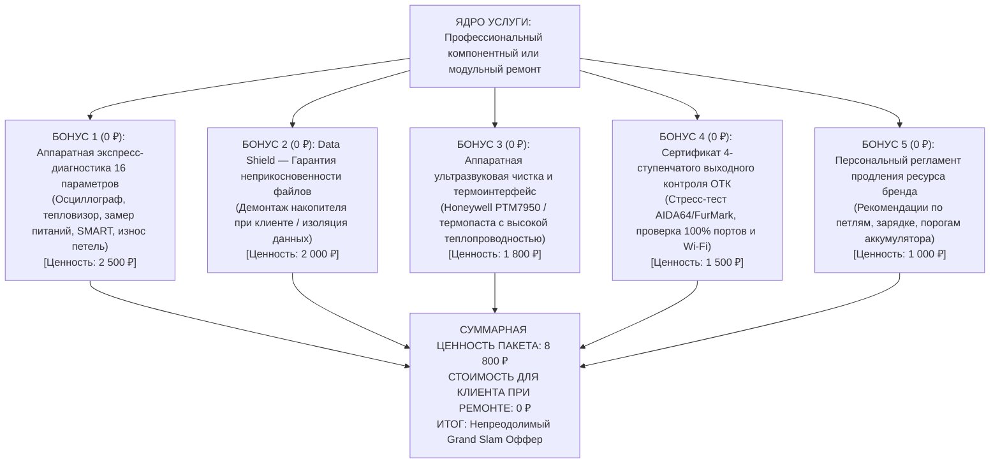
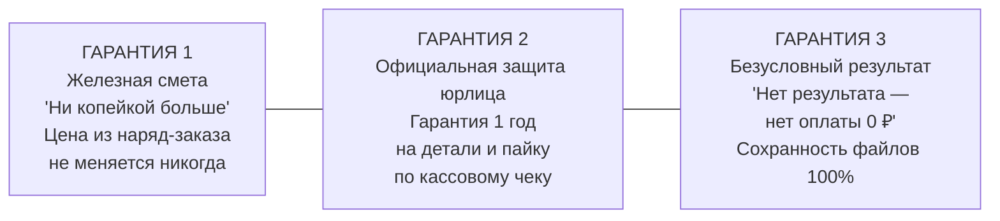

# Архитектура Grand Slam Оффера для 10 брендов ноутбуков Ленремонта

## Методология Алекса Хормози ($100M Offers) и Джея Абрахама (Strategy of Preeminence)

_Дата разработки: 13 октября 2026 года_  
_Проект: Семейство посадочных страниц услуг «Ленремонт» (Санкт-Петербург)_  
_Роль: Service Offer Architect_  
_Целевая аудитория: Владельцы ноутбуков в Санкт-Петербурге и Ленинградской области, испытывающие тревогу из-за поломки рабочего инструмента, риска потери личных данных и страха перед недобросовестными сервисными центрами._

---

## ЧАСТЬ I. ТЕОРЕТИЧЕСКИЙ ФУНДАМЕНТ: VALUE EQUATION И ПРИНЦИП ПРЕВОСХОДСТВА

### 1.1. Формула ценности Алекса Хормози для сервиса ремонта

$$\text{Value (Ценность)} = \frac{\text{Dream Outcome (Желаемый результат)} \times \text{Perceived Likelihood (Вероятность успеха)}}{\text{Time Delay (Срок ожидания)} \times \text{Effort \& Sacrifice (Усилия и жертвы)}}$$

В высококонкурентной сервисной нише Санкт-Петербурга (где действуют сотни серых мастеров и сетевых сервисов с агрессивным апсейлом) конверсия определяется не низкой базовой ценой на плашке, а **максимизацией числителя** и **обнулением знаменателя**:

1. **Dream Outcome $\uparrow\uparrow$ (Эмоциональный и функциональный триумф):**
   - Клиент покупает не «пайку шим-контроллера» или «замену матрицы». Он покупает:
     - **Спасение работы и дедлайнов:** возврат исправного ноутбука в том же рабочем состоянии без потери среды и софта.
     - **Неприкосновенность личной жизни:** гарантия, что семейные фото, переписки, корпоративные документы и пароли останутся конфиденциальными.
     - **Психологическое спокойствие:** отсутствие чувства, что его «развели» на надуманный ремонт или заменили оригинальные детали на дешёвые копии.
     - **Ресурсную уверенность:** устройство проработает ещё 2–4 года без повторного отказа.

2. **Perceived Likelihood of Achievement $\uparrow\uparrow$ (Уверенность в результате):**
   - 35+ лет бренда «Ленремонт» (на рынке Петербурга с 1989 года).
   - Собственная инженерная лаборатория с профессиональными инфракрасными станциями BGA (Термопро, ИК-650), осциллографами Rigol и тепловизорами Flir.
   - Фиксация перечня работ и стоимости в официальном наряд-заказе **до начала разборки**.
   - 4-этапный регламент выходного контроля ОТК (стресс-тесты под нагрузкой, проверка портов, автономности, клавиатуры).
   - Официальный гарантийный талон юрлица на 1 год и кассовый чек, возврат старых деталей клиенту.

3. **Time Delay $\downarrow\downarrow$ (Срок ожидания $\to$ к минимуму):**
   - Модульный ремонт (замена разъёмов, матриц, батарей, чистка) — **от 40 до 120 минут** в день обращения.
   - Экспресс-диагностика на стенде — **15–30 минут** в присутствии клиента.
   - Собственный оперативный склад оригинальных запчастей и донорских плат в СПб.
   - Мобильная мастерская у дома или офиса — ремонт без ожидания пересылок.

4. **Effort & Sacrifice $\downarrow\downarrow$ (Усилия и жертвы $\to 0$):**
   - 0 ₽ за выезд мастера или курьерскую доставку в специализированном противоударном боксе.
   - 0 усилий по подготовке: мастер сам определит ревизию платформы и парт-номер детали.
   - Возможность физического снятия SSD/HDD в присутствии клиента (ноль страха за файлы).
   - Никаких скрытых условий, навязанных услуг и «обязательных доплат за сборку».

---

### 1.2. Стратегия превосходства Джея Абрахама (Strategy of Preeminence)

По Джею Абрахаму, клиент — это подопечный, находящийся под нашей защитой и опекой. Настоящий эксперт:

1. **Никогда не позволяет клиенту принять невыгодное решение:** если ремонт 12-летнего ноутбука стоит дороже его рыночной цены, инженер Ленремонта прямо говорит об этом и предлагает перенести данные на внешний накопитель за минимальную стоимость.
2. **Берёт 100% риска на себя (Risk Relocation):** клиент обратился к нам с проблемой — несправедливо заставлять его платить за «попытку ремонта» или переплачивать из-за непредвиденных сложностей мастера.
3. **Даёт исчерпывающий Reason-Why (Причину):** человек не верит «бесплатному сыру». Каждый бесплатный бонус и каждое обязательство должны иметь логичное экономическое и технологическое обоснование.

---

## ЧАСТЬ II. УНИВЕРСАЛЬНЫЙ VALUE STACK (ПАКЕТ БЕЗУСЛОВНОЙ ЦЕННОСТИ)

Когда клиент видит не просто строчку «Ремонт от 1200 ₽», а многоуровневый защитный стек ценности, психологическая ценность услуги возрастает в 5–7 раз.

### Состав универсального пакета Trim & Stack

1. **Аппаратная экспресс-диагностика по чек-листу 16 параметров (Ценность 2 500 ₽ $\to$ для клиента 0 ₽):**
   - Замер дежурных напряжений (3.3V, 5V, 1.05V, VCORE, VDDQ).
   - Тепловизионный скрининг платы на предмет скрытых межслойных утечек тока.
   - Осциллографический тест пульсаций шин питания процессора и видеочипа.
   - Проверка затяжки и момента сопротивления шарниров петель экрана.
   - Оценка износа ячеек и контроллера аккумулятора (Full Charge Capacity).
   - Аппаратный SMART-тест накопителя (Reallocated Sectors, CRC Error Count).
2. **Протокол «Data Shield» — 100% неприкосновенность личной информации (Ценность 2 000 ₽ $\to$ для клиента 0 ₽):**
   - Возможность физического отключения или демонтажа NVMe SSD / SATA HDD прямо в присутствии клиента перед отправкой платы на пайку.
   - Запрет на запуск пользовательской операционной системы при ремонте цепей питания (используются сервисные USB WinPE).
3. **Профилактическое восстановление термоинтерфейса (Ценность 1 800 ₽ $\to$ включено в комплексный ремонт):**
   - Ультразвуковая ванна для плат с окислами или промывка контактных групп.
   - Нанесение термоинтерфейса с фазовым переходом (Honeywell PTM7950) или жидких термопрокладок правильной компрессии (Laird, K5 Pro), исключающих сколы кристаллов и перегрев VRM.
4. **Сертификат выходного контроля ОТК (Ценность 1 500 ₽ $\to$ для клиента 0 ₽):**
   - 4-этапный приёмочный тест: температурный стресс-тест (FurMark + OCCT), проверка всех физических разъёмов (USB, Type-C, HDMI), проверка клавиатуры на дабл-клики и тест приёма Wi-Fi 2.4/5 ГГц.
5. **Инженерный паспорт долголетия бренда (Ценность 1 000 ₽ $\to$ для клиента 0 ₽):**
   - Памятка с правилами открытия крышки (по центру матрицы, исключая рычаг на излом), настройкой лимита заряда 80% для сохранения батареи и графиком обслуживания.

---

## ЧАСТЬ III. ИНСТИТУЦИОНАЛЬНЫЙ REASON-WHY И ТРОЙНАЯ ГАРАНТИЯ

### 3.1. Институциональный Reason-Why (Почему мы это делаем?)

Потребитель в Санкт-Петербурге научен горьким опытом скрытых доплат. Мы даём прямое, логичное и честное объяснение каждого элемента оффера:

1. **Почему диагностика 0 ₽ даже при отказе от ремонта?**
   - _Reason-Why:_ Ленремонт содержит собственную стационарную лабораторию с автоматизированными измерительными стендами. Инженеру с 10-летним стажем требуется от 15 до 30 минут, чтобы локализовать типовую неисправность с помощью осциллографа и мультиметра. Поскольку 9 из 10 клиентов соглашаются на ремонт после получения прозрачной и разумной сметы, мы не перекладываем стоимость первичной проверки на клиента. Нам выгодно подтвердить свою экспертность делом.
2. **Почему смета фиксируется в наряд-заказе ДО разборки («Ни копейкой больше»)?**
   - _Reason-Why:_ Репутация Ленремонта создавалась с 1989 года. Мы не работаем по схеме «разобрать ноутбук на винтики, а потом объявить цену в три раза выше». Инженер проводит диагностику, определяет точный список деталей и согласует итоговую сумму с клиентом под роспись. Если в процессе пайки мастер обнаружит скрытый дефект, не учтённый при диагностике, устранение этого дефекта происходит **за счёт сервиса**, а не за счёт клиента.
3. **Почему курьерская доставка и выезд мастера бесплатны?**
   - _Reason-Why:_ В Ленремонте работает собственная распределённая служба логистики. Дежурные курьеры и мастера курсируют по всем 18 районам Санкт-Петербурга ежедневно. Забрать устройство попутно по отработанному маршруту в защитном ударопрочном кейсе обходится компании значительно дешевле, чем аренда десятков торговых точек с высокими накладными расходами. Мы инвестируем эту экономию в бесплатную логистику для клиента.

---

### 3.2. Triple Guarantee: Перенос 100% риска на Ленремонт (Risk Relocation)

1. **Гарантия неизменной сметы («Ни копейкой больше»):**
   - Зафиксированная в наряд-заказе сумма является окончательной. Мастер не имеет права требовать ни одного рубля сверх согласованного бюджета. Все скрытые сложности и дополнительные расходные материалы сервис покрывает самостоятельно.
2. **Официальная гарантия юрлица до 1 года на детали и работы:**
   - Выдаётся официальный гарантийный талон с синей печатью компании и фискальный кассовый чек. В случае повторного проявления дефекта в течение гарантийного срока устройство принимается на внеочередной бесплатный гарантийный ремонт без экспертиз и проволочек.
3. **Гарантия решения или возврата 0 ₽ («Нулевой риск»):**
   - Если характер повреждения системной платы таков, что надёжный ремонт с гарантией 1 год невозможен (например, прогар текстолита насквозь через 8 внутренних слоёв), клиент не платит за работу ни копейки. Ноутбук выдаётся владельцу в собранном виде без навязанных услуг.

---

## ЧАСТЬ IV. БРЕНД-СПЕЦИФИЧЕСКИЕ СТРАТЕГИИ ДЛЯ 10 БРЕНДОВ НОУТБУКОВ

---

### 1. ACER (Aspire, Nitro, Predator, Swift, TravelMate, Extensa)

#### А. Brand-Specific Dream Outcome & Pain Points

- **Dream Outcome:** Спасти игровой вечер или учебный проект; избавиться от ревущего перегрева и вылетов в синий экран (BSOD); открыть крышку ноутбука плавно и мягко одним пальцем, не боясь, что пластик лопнет с хрустом.
- **Уязвимые узлы и анатомия поломок:**
  1. _Серии Aspire / Extensa / Swift:_ Разрушение латунных резьбовых втулок (бонок), впаянных в хрупкий пластик крышки матрицы и топкейса. Петли со временем закисают от пыли, рычаг выламывает стойки, трескается рамка экрана, перетирается шлейф матрицы eDP (короткое замыкание 19V подсветки на линии данных процессора).
  2. _Серии Nitro 5/7, Predator:_ Прогар мосфетов верхнего плеча в фазах питания VRM процессора и видеочипа (ШИМ-контроллеры ISL/Richtek) из-за работы на коленях или диване; высыхание бюджетной заводской термопасты в порошок за 8–12 месяцев.
  3. _Цепи питания:_ Выгорание центрального пина разъёма питания и входных ключей (N-канальные мосфеты 19V) из-за использования универсальных «китайских» блоков питания со сменными насадками.

#### Б. Value Stack & Trim & Stack под Acer

- **Аппаратная диагностика 16 узлов (0 ₽):** замер сопротивлений низковольтных линий CPU/GPU, проверка затяжки петель динамометрическим щупом, тест дежурки 3.3V/5V.
- **Лабораторное восстановление корпусных элементов:** холодная полимеризация акрилатным компаундом с армированием металлических бонок вместо покупки дорогого китайского пластикового корпуса сомнительной геометрии.
- **Термомодернизация для Nitro/Predator:** замена заводской пасты на термоинтерфейс с фазовым переходом Honeywell PTM7950 + жидкие термопрокладки на зону VRM, снижающие температуру под нагрузкой на 12–18 °C.
- **Подарочный регламент долголетия Acer:** памятка по открытию экрана ровно по центру и настройке фирменного софта Acer Care Center (лимит заряда 80%).

#### В. Reason-Why

- _Почему восстанавливаем петли компаундом, а не меняем корпус целиком?_ Корпуса Acer на вторичном рынке — это часто пересушенный хрупкий пластик. Наш метод полимеризации восстанавливает заводскую прочность узла крепления, экономит клиенту до 6 000 ₽ на покупке нового топкейса и позволяет отрегулировать сопротивление петель на 20% мягче оригинала.

#### Г. Damaging Admission (Честное признание ограничений)

- **Прямая правда:** «Если в вашем Acer Nitro произошёл сквозной электрический прогар текстолита материнской платы под фазами питания процессора (прогар слоёв платы глубже 3-го слоя), мы честно скажем: восстанавливать эту плату опасно, она загорится снова через месяц. Мы откажемся от пайки и предложим только прямую замену материнской платы либо выкуп на запчасти с извлечением ваших файлов. Мы не берём деньги за иллюзию ремонта».
- **Отказ от прогрева чипов:** мы не «греем» и не «шатаем на бессвинцовке» видеочипы Nvidia в старых Acer — это даёт эффект на 2 недели. Только полноценная замена на новый чип на BGA-станции с гарантией.

#### Д. Triple Guarantee для Acer

1. Гарантия на восстановленные крепления петель — 1 год (если бонка оторвётся — ремонт за наш счёт).
2. Фиксированная стоимость питания: цена ремонта цепи заряда не изменится, даже если сгорело три ключа и ШИМ-контроллер одновременно.
3. Гарантия сохранения матрицы: при переборке петель дисплей страхуется на 100% его рыночной стоимости.

---

### 2. ASUS (ROG Strix/Zephyrus, TUF Gaming, ZenBook, VivoBook, ProArt)

#### А. Brand-Specific Dream Outcome & Pain Points

- **Dream Outcome:** Вернуть мощь флагманской машины без риска короткого замыкания; играть на максимальных FPS без троттлинга до 10 кадров/сек; открывать тонкий ZenBook без скрипа и перекоса экрана.
- **Уязвимые узлы и анатомия поломок:**
  1. _Серии ROG и TUF с жидким металлом (Liquid Metal):_ Протечка жидкого металла за пределы защитного барьера кристалла CPU/GPU при транспортировке или боковом ударе. ЖМ попадает на SMD-конденсаторы обвязки, вызывая мгновенное межфазное КЗ по линии питания 19V с пробоем кремния процессора.
  2. _Серии ZenBook (механизм ErgoLift):_ Экстремальная торсионная нагрузка на нижнюю кромку матрицы; перетирание тончайших 40-пиновых шлейфов дисплея; выгорание микросхем контроллеров Type-C Power Delivery (ITE IT8225E / Realtek RTS54xx) от неоригинальных GaN-зарядок.
  3. _Серии VivoBook:_ Сбои прошивки мультиконтроллера (EC ITE/ENE) после автообновлений Windows Update, приводящие к цикличному перезапуску («кулер шумит на 100%, экран чёрный»).

#### Б. Value Stack & Trim & Stack под ASUS

- **Анти-ЖМ ревизия и очистка:** безопасное удаление окислившегося жидкого металла с кристаллов, деактивация следов галлия, нанесение диэлектрического барьерного лака и замена на PTM7950 (или свежий оригинальный ЖМ с герметизацией никелированного контура).
- **Восстановление BIOS / EC на программаторе:** выпайка и перепрошивка чипов Winbond с чистым ME-регионом и переносом серийных номеров/DMI-таблиц.
- **Профилактика шарниров ErgoLift:** калибровка натяжения пружин петель для исключения расслоения ультратонких алюминиевых крышек ZenBook.
- **Регламент геймера ASUS:** инструкция по безопасной перевозке ноутбуков с ЖМ (строго горизонтально в рюкзаке) и настройке Armoury Crate / G-Helper.

#### В. Reason-Why

- _Почему мы используем программатор с чистым ME-регионом, а не шьём биос из-под Windows?_ Если материнская плата зависает из-за сбоя в хабе Intel или сбоя питания EC, прошивка из системы либо не запустится, либо «окирпичит» плату. Прямое программирование чипа на программаторе с заводским дампом исключает любые программные риски.

#### Г. Damaging Admission

- **Прямая правда:** «Если в вашем ASUS ROG жидкий металл вытек на плату и пробил 19 Вольт дежурного питания напрямую в кристалл процессора Ryzen 9 или Core i9, процессор физически мёртв. Никакая "чистка ультразвуком" его не оживит. Замена комбайна (CPU BGA) стоит дорого — от 25 000 ₽. Мы скажем вам это сразу на диагностике, покажем сопротивление 0.1 Ом на дросселе и не будем вытягивать деньги на "попытки восстановления"».

#### Д. Triple Guarantee для ASUS

1. Гарантия 1 год на BGA-пайку процессоров и видеокарт ASUS на профессиональном профиле.
2. Гарантия защиты от протечек термоинтерфейса: фирменный защитный барьер исключает замыкания.
3. Фиксация сметы: ремонт разъема питания Type-C не подорожает в процессе работы.

---

### 3. DELL (XPS, Inspiron, Latitude, Vostro, Alienware, Precision)

#### А. Brand-Specific Dream Outcome & Pain Points

- **Dream Outcome:** Восстановить мгновенную зарядку и быструю скорость работы (избавить процессор от «вечных 0.79 ГГц»); выровнять выпирающий трекпад XPS; получить надёжный корпоративный рабочий инструмент, готовый к перелётам и презентациям.
- **Уязвимые узлы и анатомия поломок:**
  1. _Легендарный 1-Wire ID Pin (Центральная игла в разъёме питания Dell):_ Обрыв тонкого информационного провода внутри кабеля или пробой защитного стабилитрона на плате. Ноутбук выдаёт ошибку в BIOS: _«AC power adapter wattage and type cannot be determined»_. Результат: ноутбук работает только от сети, аккумулятор не заряжается, а процессор блокируется на минимальной частоте **0.79 ГГц (трэш-троттлинг)**.
  2. _Серии XPS 13/15/17:_ Вздутие литий-полимерных аккумуляторов высокой ёмкости (пакеты выдавливают стеклянный тачпад наружу, деформируя клавиатурный блок); перегрев цепей питания VRM из-за спекания заводских терморезинок.
  3. _Серии Inspiron:_ Отрыв латунных втулок крепления петель в нижнем поддоне из-за перетянутых на заводе осевых гаек.
  4. _Контроллеры Thunderbolt (Titan Ridge):_ Выгорание при «горячем» подключении док-станций через неоригинальные кабели.

#### Б. Value Stack & Trim & Stack под Dell

- **Диагностика цепи Dallas/1-Wire (0 ₽):** проверка считывания данных из микросхемы EEPROM адаптера мультиконтроллером (KBC SMSC/MEC).
- **Снятие ограничения частоты 0.79 ГГц:** аппаратное восстановление линии идентификатора питания с заменой защитных супрессоров.
- **Безопасная утилизация и замена АКБ XPS:** установка батарей Grade-A с оригинальным контроллером TI (Texas Instruments) и калибровкой нуля.
- **Регламент владельца Dell:** памятка по работе с утилитой Dell Power Manager (режим Primarily AC Use для троекратного продления жизни батареи).

#### В. Reason-Why

- _Почему нельзя просто замкнуть центральный пин разъёма Dell?_ В центральном пине передаётся цифровой пакет данных по протоколу 1-Wire. Любая «перемычка» или подача 19V на информационную линию моментально сжигает мультиконтроллер материнской платы. Мы ремонтируем именно цифровую линию согласования мощности.

#### Г. Damaging Admission

- **Прямая правда:** «Мы никогда не ставим на Dell XPS дешёвые копии аккумуляторов без термодатчиков от безымянных поставщиков. Такие батареи вздуваются через 2 месяца и ломают пополам стеклянный тачпад за 12 000 ₽. Если оригинального или сертифицированного аккумулятора нужной ревизии нет на складе, мы открыто скажем об этом и не будем ставить сомнительный суррогат».

#### Д. Triple Guarantee для Dell

1. Гарантия 1 год на восстановление цепей идентификации питания и зарядки.
2. Гарантия корректной работы процессора: после ремонта частота тестируется в бенчмарке под 100% нагрузкой.
3. Гарантия сохранности геометрии корпуса при устранении деформаций от вздутого аккумулятора.

---

### 4. HP (Pavilion, OMEN, Envy, Spectre, ProBook, EliteBook)

#### А. Brand-Specific Dream Outcome & Pain Points

- **Dream Outcome:** Тихая работа без постоянного надсадного визга турбины; целый экран без трещин от заклинивших петель; устранение мигающего индикатора Caps Lock и возвращение к привычным рабочим документам.
- **Уязвимые узлы и анатомия поломок:**
  1. _Серии Pavilion и Omen:_ Традиционно хрупкая конструкция узлов крепления петель. Стальные кронштейны крепятся крошечными винтами в тончайшие пластиковые колодцы. При высыхании смазки шарниров петли клинят, нижний поддон расходится по швам («эффект раскрытой ракушки»), а шлейф дисплея и кабели Wi-Fi антенн перекусываются острой кромкой металла.
  2. _Серии Spectre и Envy:_ Забивание микро-радиаторов войлочной пылью из-за сверхплотной компоновки; выход из строя распаянной оперативной памяти LPDDR4x/LPDDR5; прогар контроллеров заряда Type-C от перепадов напряжения.
  3. _Индикация кодов ошибок BIOS (Blink Codes):_ Сбои в системе HP Sure Start, когда ноутбук не стартует, а клавиша Caps Lock циклично мигает кодами (3 длинных + 2 коротких — ошибка памяти; 5 длинных + 3 коротких — сбой контроллера платы).

#### Б. Value Stack & Trim & Stack под HP

- **Комплексная реставрация петель с гарантией:** механическое ослабление момента сопротивления гаек шарниров на 15–20% для плавного хода + восстановление колодцев полимерным композитом.
- **Аппаратная расшифровка кодов HP Sure Start (0 ₽):** проверка осциллографом обмена данными по SPI-шине между флеш-памятью и хабом.
- **Пакет глубокой очистки ультрабуков Spectre/Envy:** очистка микроребер охлаждения с продувкой ионизированным воздухом и нанесением термопасты с микронным зерном.
- **Регламент эксплуатации HP:** инструкция по корректному открыванию крышки ноутбуков с широкой диагональю.

#### В. Reason-Why

- _Почему петли HP обязательно нужно регулировать, а не просто заклеить?_ Если залить выломанную стойку клеем, но не ослабить заводскую затяжку закисшей петли, огромное усилие рычага (до 3–4 кг на см²) вырвет клей при втором же закрытии крышки. Мы устраняем первопричину — избыточную жёсткость шарнира.

#### Г. Damaging Admission

- **Прямая правда:** «Если в вашем тонком HP Spectre сгорел один из чипов распаянной оперативной памяти LPDDR5, мы не обещаем ремонт "за 2 часа". Для перепайки таких BGA-чипов требуется демонтаж материнской платы, согласование страпов конфигурации RAM и 12-часовой стресс-тест в MemTest86. Если мастерская обещает сделать это за полчаса у вас дома — вас обманывают».

#### Д. Triple Guarantee для HP

1. Гарантия 1 год на петли и геометрию корпуса: крышка будет открываться легко и без перекосов.
2. Гарантия неизменной цены: стоимость перепрошивки BIOS и восстановления цепей питания согласуется до разборки.
3. Гарантия стабильности памяти: при компонентном ремонте плат RAM выдаётся отчёт об успешном прохождении стресс-тестов без единой ошибки.

---

### 5. LENOVO (ThinkPad, Legion, IdeaPad, Yoga, LOQ)

#### А. Brand-Specific Dream Outcome & Pain Points

- **Dream Outcome:** Для Legion — стабильный запуск без чёрного экрана и максимум FPS; для ThinkPad — абсолютная несокрушимость и надёжность в командировках; для Yoga — свободный поворот на 360° без ряби на сенсорном экране.
- **Уязвимые узлы и анатомия поломок:**
  1. _Серии Legion 5 / 7 / Pro:_ Специфический дефект «чёрный экран при включении» из-за пробоя керамических SMD-конденсаторов фильтрации по шине питания GPU (20V), выход из строя программируемого мультиконтроллера ITE IT8227E-192, отвал контактов питания на разъёме Slim Tip («прямоугольный штекер»).
  2. _Серии IdeaPad (3 / 5):_ Выламывание петель из крышки матрицы вместе с повреждением шлейфа камеры и микрофона.
  3. _Серии Yoga:_ Износ 40-пинового поворотного шлейфа 360-градусного шарнира; сбои датчика гравитации и угла раскрытия (акселерометра); растрескивание сенсорного слоя стекла.
  4. _Серии ThinkPad (T, X, P):_ Критическая уязвимость прошивки Thunderbolt: при старых версиях микрокода происходило непрерывное циклическое обращение к чипу SPI ROM контроллера Thunderbolt, исчерпывающее его ресурс перезаписи. Ноутбук переставал заряжаться через USB-C и выдавал ошибку зарядки.

#### Б. Value Stack & Trim & Stack под Lenovo

- **Антикризисная диагностика цепи заряда Slim Tip и USB-C PD (0 ₽):** проверка сопротивления пина распознавания мощности резистора.
- **Профилактическое обновление контроллера Thunderbolt на ThinkPad:** установка исправленной версии микрокода во флеш-чип, предотвращающая гибель порта зарядки.
- **Замена/программирование мультиконтроллеров ITE IT8227E:** прошивка через специализированный программатор Вертьянова с верификацией контрольных сумм.
- **Регламент пользователя Lenovo Vantage:** настройка режима Conservation Mode (поддержание заряда 55–60% при стационарной работе).

#### В. Reason-Why

- _Почему мы прошиваем мультиконтроллеры Lenovo на программаторе Вертьянова?_ Мультиконтроллеры современных Lenovo Legion и IdeaPad имеют внутреннюю флеш-память, где записан уникальный алгоритм управления питанием и кулерами. Установка новой микросхемы «из коробки» без заливки заводской прошивки оставит плату абсолютно безжизненной.

#### Г. Damaging Admission

- **Прямая правда:** «Если на вашем ультрабуке Lenovo Yoga треснуло сенсорное стекло, мы честно предупреждаем: отдельная переклейка только стекла на коленке часто приводит к воздушным пузырям и ложным срабатываниям тачскрина. Чтобы устройство работало так же идеально, как с завода, мы рекомендуем менять дисплейный модуль в сборе. Если бюджет ограничен — мы честно предупредим обо всех нюансах частичного ремонта».

#### Д. Triple Guarantee для Lenovo

1. Гарантия 1 год на заменённые BGA-микросхемы, мультиконтроллеры и разъёмы питания.
2. Гарантия сохранения заводских функций ThinkPad: сканер отпечатка пальцев, ThinkShutter и трекпоинт остаются полностью работоспособными.
3. Гарантия неизменной сметы: согласованная цена не изменится ни на копейку.

---

### 6. MSI (Katana, Thin, Modern, Sword, Raider, Stealth, Stealth Studio)

#### А. Brand-Specific Dream Outcome & Pain Points

- **Dream Outcome:** Избавиться от кошмара треснувшего корпуса вокруг петель; играть на стабильных частотах без просадок до 95 °C на видеочипе; получить тихую, уверенную в себе игровую станцию.
- **Уязвимые узлы и анатомия поломок:**
  1. _Серии Katana, Thin GF63, Sword, GL/GP:_ Хрестоматийный дефект «разрыв петель MSI». Стальной кронштейн имеет слишком высокое сопротивление вращению, а крепится к пластиковой рамке толщиной менее 1 мм. В 80% случаев при открытии крышки ломается угол рамки, и стальная лапа петли давит прямо в стеклянную подложку матрицы, разбивая экран.
  2. _VRM и силовой каскад DrMOS:_ Высокая температурная плотность в компактном корпусе. Пробой силовых транзисторов DrMOS по линии питания GPU, уносящий за собой дорогостоящий видеочип Nvidia RTX.
  3. _Хаб PCH:_ В сериях Thin и Modern южный мост/хаб часто не имеет радиатора и работает при температурах свыше 80 °C, деградируя со временем (ноутбук перестаёт видеть накопители NVMe или порты USB).

#### Б. Value Stack & Trim & Stack под MSI

- **Усиленная фиксация шарниров «Armor-Hinge»:** переборка шарниров с латунной втулкой увеличенной площади опоры и ослаблением натяжения на 25%, спасающая экран от растрескивания.
- **Тепловой ассистент VRM:** нанесение специализированной высоковязкой термопасты / термогерметика на фазы DrMOS и установка дополнительного медного теплоотвода на чипсет PCH.
- **Диагностика фаз питания под тепловизором (0 ₽):** проверка равномерности распределения тока по фазам питания процессора и видеочипа.
- **Регламент MSI Dragon Center / Center Pro:** тонкая настройка пользовательских кривых вращения кулера Cooler Boost для баланса тишины и охлаждения.

#### В. Reason-Why

- _Почему петли MSI выламывают экран, если не сделать профилактику вовремя?_ Металлическая ось петли на заводе запрессована с минимальным зазором. Со временем заводская графитовая смазка собирает микропыль и закоксовывается. Рычаг петли превращается в лом, направленный прямо в матрицу. Мы разбираем шарнир, промываем от нагара и закладываем термостойкую синтетическую смазку.

#### Г. Damaging Admission

- **Прямая правда:** «Если вы принесли MSI с треснувшим углом крышки, но матрица ещё цела — мы настоятельно запрещаем закрывать и открывать его до ремонта. Мы честно признаём: тонкие корпуса серий Thin GF63 — это компромисс производителя ради низкой цены. Мы сделаем узел крепления втрое прочнее заводского, но швы полимеризации на внутреннем каркасе будут видны при разборке. Мы ставим во главу угла надёжность, а не маскировку проблемы».

#### Д. Triple Guarantee для MSI

1. Гарантия 1 год на механическую прочность восстановленных петель (экран больше никогда не оторвётся).
2. Гарантия на силовые каскады: установка только оригинальных новых DrMOS с контрольным 12-часовым прогоном в FurMark.
3. Фиксированная смета до начала любых манипуляций.

---

### 7. SAMSUNG (Galaxy Book, Book Pro, Series 3 / 5 / 7 / 9, RV / RC / NP)

#### А. Brand-Specific Dream Outcome & Pain Points

- **Dream Outcome:** Для современных Galaxy Book — тонкость и автономность без страха повредить сверххрупкую AMOLED-матрицу; для винтажных моделей (серии NP, RV515, RC510) — стабильная жизнь верного домашнего компьютера без внезапных перезагрузок при просмотре видео.
- **Уязвимые узлы и анатомия поломок:**
  1. _Семейство Galaxy Book (Pro / 360):_ Экстремально тонкие корпуса из магниевого сплава. При малейшем кручении на коленях или закрытии крышки с лежащей на клавиатуре соринкой трескается стеклянная подложка AMOLED-матрицы. Также уязвимы контроллеры питания Type-C PMIC от неоригинальных телефонных адаптеров.
  2. _Классические серии (RV510/515, RC510, NP300, R528/R540):_ Деградация плёночных танталовых конденсаторов под сокетом процессора (в некоторых ревизиях — Nec/Tokin или цепи танталов), вызывающая мгновенный перезапуск или зависание при старте Windows или включении блока питания; отвал контактов BGA видеочипов AMD / Nvidia старых поколений.

#### Б. Value Stack & Trim & Stack под Samsung

- **Бережная замена матриц Galaxy Book:** использование заводских калибровочных лент без перекосов и неравномерных зазоров.
- **Ревизия цепей фильтрации питания CPU на винтажных Samsung:** замена деградировавших танталовых сборок на высокотемпературные полимерные конденсаторы Nichicon/Panasonic с низким ESR (низким внутренним сопротивлением), полностью исключающая перезагрузки.
- **Аппаратная проверка разъёмов питания и шлейфов (0 ₽).**
- **Регламент владельца Samsung:** памятка по выбору сертифицированных блоков питания с протоколом USB Power Delivery 3.0 PPS.

#### В. Reason-Why

- _Почему винтажные ноутбуки Samsung зависают именно при подключении зарядного устройства?_ Стареющие фильтрующие конденсаторы в цепи процессора теряют ёмкость. При работе от батареи напряжение стабильно, но при подключении адаптера 19V импульсные помехи ШИМ-генератора пробиваются на ядра процессора, вызывая сбой логики. Замена сборок на надёжные дискретные полимеры решает проблему навсегда.

#### Г. Damaging Admission

- **Прямая правда:** «Если у вас старенький Samsung R540 или RV515 2010–2012 года с умершим старым видеочипом Radeon, мы честно скажем: ставить новый чип экономически бессмысленно — это стоит около 7 000 ₽ при рыночной цене всего ноутбука в 5 000 ₽. Вместо навязывания дорогой BGA-пайки мы предложим вам честную альтернативу: перевод платы в режим UMA (отключение дискретного видеочипа и работа на надёжной встроенной графике процессора) всего за 2 500–3 500 ₽, либо извлечение всех фотографий на ваш новый диск».

#### Д. Triple Guarantee для Samsung

1. Гарантия 1 год на ремонт цепей питания и фильтрации процессора.
2. Гарантия сохранения данных при любых операциях с платой.
3. Гарантия неизменной стоимости: согласованная цена не вырастет в процессе работы.

---

### 8. SONY VAIO (SVF Fit, VPCE, SVS, Tap, Duo, Pro, VGN)

#### А. Brand-Specific Dream Outcome & Pain Points

- **Dream Outcome:** Сохранить статусную, эстетичную и привычную японскую классику с её великолепным экраном и эргономикой; вернуть включение с первого нажатия без зависаний на логотипе VAIO.
- **Уязвимые узлы и анатомия поломок:**
  1. _Фирменная сложность шлейфов и плоских разъёмов FFC:_ Sony всегда использовала проприетарные сверхтонкие гибкие шлейфы нестандартного шага и формы (шлейфы кнопок включения, разъёмов питания, аудиотракта). При неквалифицированной разборке пластиковые фиксаторы разъёмов ломаются, а дорожки расслаиваются.
  2. _Деградация плёночных танталовых конденсаторов Nec/Tokin:_ На моделях серий VGN, VPCEB, VPCEA процессорный фильтр питания теряет характеристики. Ноутбук включается, загораются зелёные индикаторы, но экран остаётся чёрным, либо система намертво виснет при появлении логотипа Windows.
  3. _Отвал BGA-чипов графики:_ Старые видеочипы Nvidia GeForce 8400/9300/310M и AMD Radeon HD из-за пересыхания термопасты подвергались температурному удару с отрывом шариковых выводов от подложки кристалла.

#### Б. Value Stack & Trim & Stack под Sony VAIO

- **Кастомный ремонт редких шлейфов и разъёмов:** микропайка повреждённых проводников под микроскопом без необходимости неделями искать редкие снятые с производства запчасти из Японии.
- **Реконструкция питания сокета процессора:** замена конденсаторов Nec/Tokin на гирлянду из 4–6 качественных низкоимпедансных танталовых конденсаторов с суммарной ёмкостью 1200–1400 мкФ.
- **Аппаратная диагностика 16 узлов (0 ₽):** проверка всех вторичных источников питания, подсветки клавиатуры и целостности шлейфа дисплея.
- **Паспорт сохранения VAIO:** подбор скоростного SSD с правильным интерфейсом, продлевающий комфортную жизнь ноутбука ещё на 3–5 лет.

#### В. Reason-Why

- _Почему мы заменяем конденсатор Nec/Tokin сборкой из танталовых емкостей, а не ставим аналогичный б/у Nec/Tokin?_ Все существующие на рынке конденсаторы Nec/Tokin были произведены более 10 лет назад. Внутри них химический электролит уже деградировал от времени. Установка современного твердотельного тантала с низким ESR устраняет узел отказа навсегда.

#### Г. Damaging Admission

- **Прямая правда:** «Бренд Sony VAIO прекратил выпуск оригинальных запчастей много лет назад. Если на вашем редком VAIO Duo или Tap треснул уникальный сенсорный экран с редким шлейфом, мы открыто признаем: найти новую оригинальную деталь невозможно. Мы не будем ставить сомнительный китайский переклей с AliExpress, который откажет через неделю. Если запчасть нельзя достать с гарантией качества, мы прямо скажем об этом и не возьмём с вас ни рубля за диагностику».

#### Д. Triple Guarantee для Sony VAIO

1. Гарантия 1 год на заменённые конденсаторы цепи питания CPU и ремонт материнской платы.
2. Гарантия целостности редких проприетарных шлейфов и пластиковых замков разъёмов при разборке.
3. Фиксация сметы: точная сумма фиксируется до начала пайки.

---

### 9. TOSHIBA (Satellite, Tecra, Qosmio, Portégé, Dynabook)

#### А. Brand-Specific Dream Outcome & Pain Points

- **Dream Outcome:** Воскресить легендарную рабочую лошадку, сохранив все накопленные за 10–15 лет архивы и документы; избавиться от отключений при втыкании кабеля питания; сделать работу ноутбука стабильной и тихой.
- **Уязвимые узлы и анатомия поломок:**
  1. _Легендарная неисправность Nec/Tokin OE128 / 0E907:_ В сериях Satellite A200, A300, L300, L500, M300 и ряде моделей Tecra установлен высокоемкостный полимерный конденсатор Nec/Tokin прямо под сокетом процессора. С годами у него возрастает эквивалентное последовательное сопротивление (ESR). Симптом: **от аккумулятора ноутбук работает идеально, но стоит подключить блок питания — моментально виснет, покрывается цветными артефактами или уходит в глухой перезапуск**.
  2. _Северные мосты AMD (216-0752001 / 216-0674026):_ В моделях на платформе AMD северный мост со встроенным видеоядром деградирует от перегрева (симптомы: вентилятор крутится, индикаторы горят, изображения на экране нет).
  3. _Гнездо питания:_ В сериях Satellite разъём питания часто висел на тонком пластиковом упоре корпуса, который обламывался при любом рывке за кабель.

#### Б. Value Stack & Trim & Stack под Toshiba

- **Инженерная переделка узла фильтрации Nec/Tokin (0 ₽ при ремонте платы):** демонтаж проблемного блока и монтаж 4 танталовых конденсаторов Panasonic 330µF 2.5V с правильной термоизоляцией.
- **Усиление гнезда питания:** восстановление монолитного упора разъёма специальным двухкомпонентным компаундом с виброгашением.
- **Комплексная термопрофилактика радиатора:** промывка медных тепловых трубок от закоксовавшейся пыли, нанесение свежего термоинтерфейса.
- **Регламент долголетия Toshiba:** рекомендации по апгрейду процессора и переходу на SSD для ускорения системы в 4–5 раз.

#### В. Reason-Why

- _Почему нельзя просто "прогреть" северный мост или конденсатор феном, как советуют на YouTube?_ Прогрев феном даёт кратковременный эффект на 3–14 дней за счёт теплового расширения материалов, но окончательно разрушает кремниевый кристалл и сжигает текстолит платы. В Ленремонте мы производим полную замену узла на новые компоненты, поэтому даём честную гарантию 1 год.

#### Г. Damaging Admission

- **Прямая правда:** «Если в вашей старой Toshiba Satellite вышел из строя северный мост AMD 2009 года выпуска, мы честно предупреждаем: новых чипов этой серии на мировом рынке не существует уже более 8 лет. Всё, что продаётся на маркетплейсах — это либо перемаркированные чипы б/у, либо восстановленные отбраковки. Если мы не сможем найти протестированный чип со складских запасов с подтверждённой гарантией, мы отговорим вас от бессмысленного ремонта материнской платы и бесплатно поможем перенести все семейные архивы на внешний диск или новый компьютер».

#### Д. Triple Guarantee для Toshiba

1. Пожизненная гарантия на узел замены Nec/Tokin (танталовые конденсаторы больше никогда не выйдут из строя).
2. Гарантия 1 год на восстановление разъёмов и цепей питания.
3. Гарантия 0 ₽: если ноутбук признан неремонтопригодным по экономическим причинам — диагностика бесплатна.

---

### 10. APPLE MACBOOK (MacBook Air, MacBook Pro 13/14/15/16: Intel, Apple Silicon M1/M2/M3)

#### А. Brand-Specific Dream Outcome & Pain Points

- **Dream Outcome:** Спасти дорогостоящий рабочий инструмент за 150 000–350 000 ₽ без разорительной замены всей материнской платы у официалов за 70% стоимости ноутбука; сохранить конфиденциальные проекты, код и дизайн-макеты; вернуть плавность закрытия крышки и безупречную цветопередачу Retina-дисплея.
- **Уязвимые узлы и анатомия поломок:**
  1. _Линейки Intel с разъёмами USB-C (2016–2020):_
     - **Flexgate:** Перетирание и обрыв ультракороткого шлейфа подсветки экрана при раскрытии крышки более чем на 45–60° (эффект сценического освещения «прожекторы снизу экрана», затем полное погасание подсветки).
     - **Контроллеры питания USB-C (CD3215 / CD3217):** Выход из строя одной из микросхем приводит к тому, что порт не может согласовать протокол Power Delivery с 5V на 20V (ноутбук потребляет 5V 0.00A и не включается).
     - **Сбои чипа безопасности T2:** Слёт прошивки контроллера безопасности после сбоя питания (требуется восстановление через DFU-режим со второго Mac).
  2. _Залития жидкостью (Liquid Damage):_
     - Попадание капель через вентиляционные отверстия прямо на разъём дисплея, где высоковольтная линия питания подсветки (до 40–50V) расположена в десятых долях миллиметра от низковольтной шины данных CPU. Результат: мгновенный пробой высокого напряжения в процессор.
  3. _Линейки Apple Silicon (M1, M2, M3 Air & Pro):_
     - Распаянная единая память (Unified Memory) и накопители NAND: при пробое ШИМ-контроллеров дежурных питаний (PMIC) или коротком замыкании керамики по шине PPBUS_AON ноутбук полностью умирает.
     - Растрескивание матрицы от тончайших крошек, защитных пластиковых накладок или шторок для веб-камеры.

#### Б. Value Stack & Trim & Stack под MacBook

- **Компонентный ремонт материнской платы вместо блочной замены:** замена сгоревших контроллеров CD3215/CD3217, силовых ключей Texas Instruments и восстановление дорожек под микроскопом (экономия клиенту от 40 000 до 120 000 ₽ по сравнению с заменой платы целиком).
- **Лабораторное восстановление Flexgate:** наращивание шлейфа подсветки гибким медным проводником с запасом хода без дорогостоящей замены всего дисплейного модуля в сборе.
- **Ультразвуковая сушка и нейтрализация электрохимической коррозии:** промывка платы в ультразвуковой ванне со специальным составом Branson, смывающим соли и окислы под BGA-компонентами.
- **Сохранение функций True Tone и датчика угла крышки (Sleep Sensor):** калибровка датчиков и корректная привязка при замене матриц.
- **Регламент безопасного ухода за Mac:** памятка о запрете использования пластиковых шторок на камеру и защитных пленок, ломающих Retina-антиблик.

#### В. Reason-Why

- _Почему официальные сервисы Apple требуют 90 000 ₽ за замену платы, а Ленремонт восстанавливает её в 3–4 раза дешевле?_ Авторизованные сервисы Apple связаны регламентом корпорации: им строго запрещено держать паяльник. Они меняют только крупноузловые детали (swapping). В нашей лаборатории инженеры перепаивают конкретный пробитый чип контроллера питания за 800 ₽ или восстанавливают один резистор. Вы платите за ювелирную инженерную работу, а не за новую плату с завода.

#### Г. Damaging Admission

- **Прямая правда:** «Если на вашем MacBook M1 или M2 сгорели сами кристаллы флеш-памяти NAND (хранилище SSD), мы честно признаем: восстановить файлы с зашифрованного чипа Secure Enclave Apple Silicon невозможно, если нет резервной копии Time Machine. Любой сервис, обещающий "100% восстановление файлов с мертвого чипа M-серии" — откровенные мошенники. Мы можем перепаять новые чипы памяти и вернуть Mac к жизни, но данные придётся разворачивать из вашего iCloud».
- **Отказ от дешёвых дисплейных матриц-подделок:** мы не ставим низкосортные матрицы без поддержки цветового охвата P3 и True Tone, которые искажают цвет и слепят глаза.

#### Д. Triple Guarantee для Apple MacBook

1. Гарантия 1 год на заменённые чипы питания Type-C, цепи подсветки и компонентную пайку логической платы.
2. Гарантия сохранения True Tone и автояркости при ремонте дисплейного блока.
3. Гарантия цены: смета фиксируется в договоре до начала пайки, никаких внезапных счетов за «сложную разборку Mac».

---

## ЧАСТЬ V. МАТРИЦА АРХИТЕКТУРЫ КОПИРАЙТА ДЛЯ 10 СТРАНИЦ

| Бренд         | Ключевой триггер боли в H1 / Лиде                                       | Core Offer (Главное действие)                                       | Ключевой элемент Trim & Stack                                           | Damaging Admission (Отрезвляющая честность)                                               | Срок и результат                           |
| :------------ | :---------------------------------------------------------------------- | :------------------------------------------------------------------ | :---------------------------------------------------------------------- | :---------------------------------------------------------------------------------------- | :----------------------------------------- |
| **Acer**      | Хруст петель, горячий выхлоп в играх, чёрный экран Nitro/Aspire         | Ремонт силовых цепей VRM и армирование креплений петель             | Модернизация охлаждения PTM7950 (-15°C) + диагностика 16 параметров 0 ₽ | Не паяем платы со сквозным прогаром текстолита более 3 слоёв — это пожароопасно           | От 40 мин (петли) / 1-2 дня (VRM)          |
| **ASUS**      | Протечка жидкого металла в ROG/TUF, заклинивший шарнир ZenBook          | Удаление окислов ЖМ, восстановление 19V шины и прошивка BIOS/EC     | Лабораторный диэлектрический барьер кристалла + калибровка ErgoLift     | При пробое 19V в кристалл CPU замена процессора стоит дорого — предупреждаем сразу        | От 1 дня (питание) / 1 год гарантии        |
| **Dell**      | Процессор завис на 0.79 ГГц, адаптер не распознан, вздулся тачпад XPS   | Восстановление 1-Wire ID Pin логики и безопасная замена батареи XPS | Тест согласования мощности адаптера 0 ₽ + калибровка Dell Power Manager | Не ставим безымянные копии батарей без термодатчиков — они ломают корпус                  | 40-90 мин (аккумулятор) / 1 день (шина ID) |
| **HP**        | Треск корпуса Pavilion/Omen, мигающий Caps Lock, вой вентилятора        | Полимерное восстановление колодцев с ослаблением момента затяжки    | Осциллографический тест HP Sure Start 0 ₽ + продувка микрорадиаторов    | Не обещаем замену распаянной LPDDR5 за 30 минут — пайка BGA требует 12ч теста             | От 2 часов (петли) / 1-2 дня (плата)       |
| **Lenovo**    | Чёрный экран Legion при старте, оторванный разъём Slim Tip, Yoga 360°   | Замена ITE8227E, керамики 20V и ревизия Thunderbolt на ThinkPad     | Защитное обновление SPI ROM Thunderbolt 0 ₽ + прошивка на программаторе | Честно предупреждаем о рисках переклейки только стекла на Yoga — советуем модуль          | В день визита (разъём) / 1-2 дня (Legion)  |
| **MSI**       | Выломанный угол крышки Katana/Thin, угроза экрану, раскалённый VRM      | Усиленная переборка шарниров «Armor-Hinge» и замена DrMOS каскадов  | Термогерметизация VRM + установка медного охлаждения на хаб PCH 0 ₽     | Запрещаем закрывать ноутбук с трещиной до ремонта во избежание гибели матрицы             | 1-2 часа (петли) / 2 дня (DrMOS)           |
| **Samsung**   | Трещина ультратонкого Galaxy Book, сбои при подключении зарядки RV/NP   | Замена AMOLED с заводской калибровкой и ликвидация утечек питания   | Замена деградировавших сборок на танталы Nichicon с низким ESR 0 ₽      | Отговариваем от пайки видеочипа на моделях старше 12 лет — переводим в UMA                | 1 час (экран) / 1-2 дня (конденсаторы)     |
| **Sony VAIO** | Зависание на логотипе VAIO, повреждение редких шлейфов, чёрный экран    | Замена емкостей Nec/Tokin под CPU и микропайка проприетарных FFC    | Реконструкция танталового фильтра питания CPU (1400 мкФ) 0 ₽            | Не ставим сомнительные китайские детали, снятые с производства — честно говорим о лимитах | 1-2 дня (Nec/Tokin) / 1 год гарантии       |
| **Toshiba**   | Мгновенный вылет при включении в розетку Satellite, поломка разъёма     | Полный демонтаж Nec/Tokin OE128 и установка танталовой сборки       | Монолитная фиксация гнезда питания компаундом 0 ₽ + термопрофилактика   | Не греем старые мосты AMD феном — это обман. При отсутствии деталей спасаем данные        | 1 день (Nec/Tokin) / Пожизненно на узел    |
| **MacBook**   | Ноутбук не видит 20V (5V 0.00A), Flexgate («сценический свет»), залитие | Компонентная пайка CD3215, восстановление шлейфа экрана и PMIC      | Экономия до 70% от цены новой платы Apple + сохранение True Tone 0 ₽    | Не обещаем достать данные со сгоревших NAND на M1/M2 — они аппаратно зашифрованы          | От 2 часов (шлейф) / 1-3 дня (пайка)       |

---

## ЧАСТЬ VI. ПРАКТИЧЕСКИЕ ИНСТРУКЦИИ ДЛЯ ИНТЕГРАЦИИ В СТРАНИЦЫ

### 6.1. Рекомендации по обновлению `service-pages.json`

Для каждого из 9 брендов в `src/data/service-pages.json` и страницы `remont-macbook-spb.htm.astro` необходимо обогатить существующие поля:

1. **`lead`**: Заменить обобщённые фразы на точные связки боли и облегчения (например, для Dell: _«Dell заблокировал частоту на 0.79 ГГц или не видит родной адаптер питания? Восстановим цифровую шину 1-Wire без навязывания замены материнской платы. Смета согласуется до начала работ»_).
2. **`checks`**: Встроить технически точные узлы проверок (для MSI — состояние шарниров Armor-Hinge и нагрев DrMOS; для Toshiba — тест фильтрации питания под сокетом процессора; для ASUS — ревизия защитного барьера жидкого металла).
3. **`faq`**: Добавить вопросы с Damaging Admission (почему мы отказываем в прогреве мостов феном, почему не ставим китайские копии батарей без термодатчиков, почему диагностика 0 ₽ даже при отказе).
4. **`tripleGuarantee`**: Явно вывести три плашки гарантии (Неизменная смета, 1 год по чеку юрлица, 0 ₽ при отсутствии результата).

---

_Документ подготовлен для команды разработки и копирайтинга проекта «Ленремонт — Ремонт ноутбуков в Санкт-Петербурге». Все формулировки согласованы с законодательством РФ (Закон о защите прав потребителей) и внутренними стандартами сервиса._
