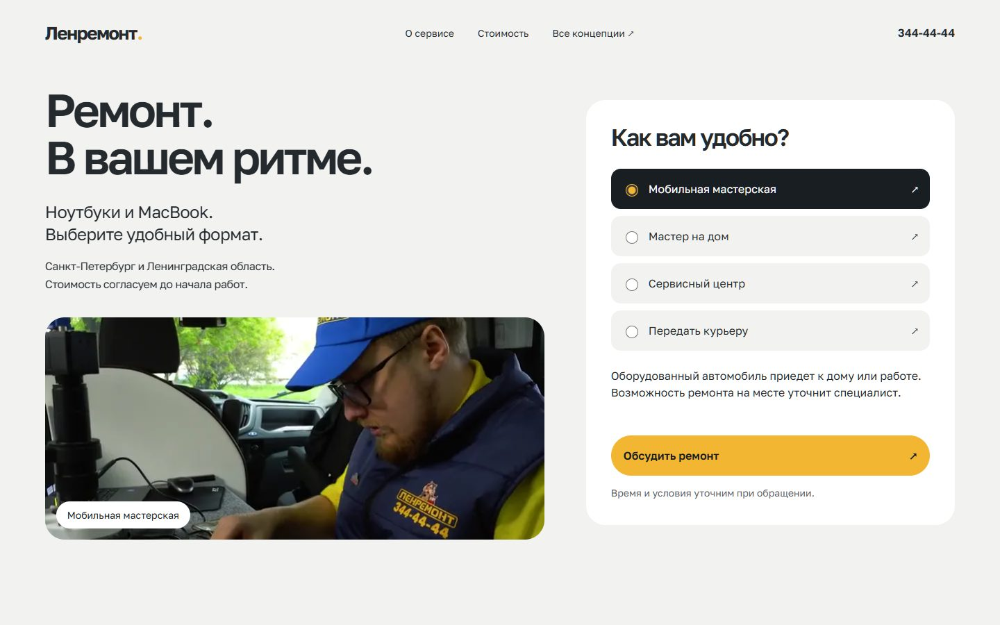

# Дизайн-система v2 — «В вашем ритме»

Версия 1.2 · 29 октября 2026 · проект lr-remont-noutbykov.

**Актуальный прайс главной — `verified`:** «Сколько стоит ремонт ноутбука», тёмный ориентир с тремя нативными вариантами от 2 390 / 3 190 / 4 990 ₽; полный прайс — две details-группы (12 работ ноутбуков открыты, шесть MacBook закрыты), сроки/оплата — отдельные раскрытия. Все 18 работ/цен/сроков и SHA-256 prices/timeline/benefits сохранены. Quality PASS, build 56 страниц в 21:07:51 Europe/Moscow и 14/14 Node-тестов PASS; root проверил 1440/768/390/320 без overflow, стабильную высоту результата, ArrowDown/Space и CTA → phone focus → Escape. Без JS подтверждён выбор экрана с видимой ценой от 3 190 ₽. Доказательства и границы — в [журнале 34](34_DESIGN_SYSTEM_IMPLEMENTATION.md). DS-28 остаётся in progress; прежние Lighthouse не характеризуют эту версию.

**Агрегаторы отзывов:** по странице-образцу добавлены Яндекс Карты, 2ГИС и Google: светлые карточки с крупной оценкой, золотыми звёздами и количеством оценок, три колонки desktop / две mobile. Показатели атрибутируются странице Ленремонта с датой наблюдения, отдельно от прежних проверенных рейтингов филиалов. Карусель отзывов сохранена. Источники, снимки и фактическая приёмка — в [журнале 34](34_DESIGN_SYSTEM_IMPLEMENTATION.md).

**Актуальные преимущества главной:** четыре основных пункта без поясняющих абзацев — диагностика в мастерской — 0 ₽, смета до начала работ, гарантия на ремонт — 1 год, проверка перед оплатой. На desktop — два ряда по два пункта, на узком mobile — одна колонка. Полная версия шести пунктов с пояснениями сохраняется на брендовых страницах. Приёмка компактной версии записывается в [журнал 34](34_DESIGN_SYSTEM_IMPLEMENTATION.md).

**Предыдущий checkpoint действий и QR — `verified`:** основное действие «Узнать стоимость ремонта» открывает существующий квиз; второе «Оставить заявку» — обычный lead-диалог. QR в SocialLinks — постоянно видимые прямые ссылки без details: две колонки mobile, четыре desktop. Quality и 14 Node-тестов PASS; root проверил 1440/768/600/390/320 без overflow, оба диалога и возврат фокуса, все восемь QR видны и загружены. Lighthouse ниже относится к предыдущей версии и не подтверждает производительность этой итерации.

Действующая система выбранного третьего направления: жемчужный фон, графит, белые поверхности и яркое золото. Она перенесена на production-главную, страницы брендов, неисправностей и самостоятельную MacBook. `/design-directions/service/` сохраняет историю выбранного макета. Фактический охват проверок и ограничения собраны в [журнале внедрения 34](34_DESIGN_SYSTEM_IMPLEMENTATION.md).

**Предыдущий возврат первого экрана — `verified`:** первый экран главной возвращён к виду до внедрения — тёмная композиция, видео и прежний CTA вместо панели форматов с фото. Восстановлен фактический baseline H1 «Ремонт ноутбуков на дому или в сервисном центре», без eyebrow и обещания «40–90». Quality и 14 Node-тестов PASS; root проверил 1440/768/390/320 без overflow, один H1, видео с controls/muted и CTA → диалог → Escape с возвратом фокуса. Эти доказательства предшествуют последующему уточнению CTA/преимуществ/QR выше. Общая система остальных секций сохраняется. Предыдущие Lighthouse относятся к версии до возврата и не характеризуют новый первый экран. Доказательства и ограничения — в журнале 34. Preview проекта: [http://127.0.0.1:4324/](http://127.0.0.1:4324/).

План работ: [33_REDESIGN_IMPLEMENTATION_PLAN.md](33_REDESIGN_IMPLEMENTATION_PLAN.md). Реализация и доказательства: [34_DESIGN_SYSTEM_IMPLEMENTATION.md](34_DESIGN_SYSTEM_IMPLEMENTATION.md). История выбора: [30_DESIGN_DIRECTIONS.md](30_DESIGN_DIRECTIONS.md), [31_SERVICE_DIRECTION_CONTINUATION.md](31_SERVICE_DIRECTION_CONTINUATION.md). Прежняя система: [02_DESIGN_SYSTEM.md](02_DESIGN_SYSTEM.md).

## 1. Решения и границы

| Статус                   | Содержание                                                                                                                                                                |
| ------------------------ | ------------------------------------------------------------------------------------------------------------------------------------------------------------------------- |
| Выбрано пользователем    | «В вашем ритме», три следующие секции, нейтральная палитра и яркое золото вместо пыльного шампанского                                                                     |
| Реализовано в production | Общие токены и роли; главная и три семейства детальных страниц; выбор формата/цены, нативные этапы/FAQ/QR, формы с сохранением контекста                                  |
| Проверено                | Сборка и Node-регрессии, все 51 production-маршрут статически, выбранные страницы и взаимодействия в браузере в фактическом объёме журнала 34                             |
| Границы проверки         | Local fonts реализованы; лабораторные LCP/CLS проверены отдельно. 200% browser zoom, полный NVDA/VoiceOver, реальная доставка заявки и полевые показатели не подтверждены |

`#F2B632` — выбранный и реализованный акцент. `#C9AE79` и ранняя голубая версия — история. Hover, границы, функциональные состояния и размеры ниже описывают рабочую систему; их реализация не означает отдельного утверждения пользователем каждого промежуточного значения.

Сохраняются название и характер Ленремонта, реальные материалы компании, состав услуг, источники данных и маршруты. Близость к Apple понимается как ясная иерархия, качество деталей и понятное поведение. Не копируются фирменные знаки, San Francisco, интерфейс macOS или рекламные обещания Apple.

### Приоритет источников

1. Последние прямые решения пользователя.
2. Этот документ — целевая визуальная система; документ 33 — порядок внедрения.
3. [21_HOME_PAGE_ARCHITECTURE.md](21_HOME_PAGE_ARCHITECTURE.md) — утверждённая архитектура главной с последующими дополнениями текущего проекта, включая BusinessTrust.
4. JSON и действующие компоненты — цены, адреса, отзывы и технические контракты. Конфликтующие обещания проверяются по источнику, а не автоматически наследуются из кода.
5. Документы 22, 25, 26, 29 — происхождение содержания и медиа. Старые отчёты не заменяют новую сверку фактов.

Порядок четырёх секций макета не заменяет порядок всей главной. Перестановка отзывов, цен, квиза или адресов не входит автоматически в визуальную миграцию.

## 2. Идея и визуальная грамматика

**Сервис, который подстраивается под человека и объясняет свои действия.** Премиальность выражается точностью выбора, спокойным пространством, настоящей мастерской и ясной ценой.

| Принцип                   | Проявление                                                                     | Чего избегаем                                            |
| ------------------------- | ------------------------------------------------------------------------------ | -------------------------------------------------------- |
| Один главный смысл        | Короткий заголовок, полезное пояснение, основное действие в локальном сценарии | Несколько равнозначных золотых кнопок в одной панели     |
| Крупное настоящее медиа   | Инженер, автомобиль, оборудование, интерьер с известным происхождением         | Синтетические сотрудники, вымышленные результаты ремонта |
| Разные композиции         | Открытый текст → медиа на графите → белый интерфейс → содержательный список    | Вся страница как одинаковая сетка карточек               |
| Точечный яркий акцент     | Золото выделяет действие; выбранный вариант может быть графитовым              | Золотой текст и рамки вокруг каждого блока               |
| Понятный выбор            | Нативные radio, details, реальные ссылки, форма с контекстом                   | Декоративные переключатели без результата                |
| Содержание важнее эффекта | Текст, условия и цена доступны до анимации и без квиза                         | Скрытая до скролла информация                            |

Большой радиус используется на больших поверхностях, а не на каждом абзаце. Визуальные границы создают пространство, цвет и композиция. Рамки нужны полям, таблицам и состояниям выбора. Постоянные тени, градиенты, блеск металла, свечения, декоративные линии и мелкие прописные надписи в систему не входят.

После двух-трёх плотных блоков нужен более открытый блок с медиа или коротким выводом. Это достигается оформлением предусмотренных секций, а не добавлением пустых экранов. Не ставить два огромных тёмных блока подряд. Адреса, FAQ и прайс должны оставаться удобными для быстрого просмотра.

## 3. Архитектура токенов

Три слоя: **базовое значение → смысловая роль → роль компонента**. Единственный исполняемый источник — `src/styles/core/_variables.scss`. Отдельный JSON-генератор, пакет токенов или новая библиотека сейчас не нужны.

- Переменные объявляются на `#hop-landing`, не на `:root` и не на body.
- Все собственные селекторы явно ограничены `#hop-landing`, классы имеют префикс `lr-`.
- SCSS остаётся в `src/styles`; в Astro-компоненты стили не переносятся.
- Компоненты используют смысловые переменные; HEX — в базовом слое, а не десятками в секциях.
- Действующие имена `--lr-color-*`, `--lr-button-*`, `--lr-input-*` сохраняются, где их смысл подходит.
- `--lr-concept-*` остаются пространством прототипа. В production нужна общая система, а не постоянный каскад `:has(.lr-concept--service)`.

### 3.1. Базовая палитра

Значения сверены с src/styles/core/_variables.scss. Имена --lr-blue-_, --lr-amber-_ и --lr-stone-* сохранены как совместимые aliases на новую палитру: blue-700 → neutral-600, blue-50/100 → pearl-100, amber-400 → gold-400, amber-600 → контрастная bronze-700 для прежних текстовых потребителей. Это не отдельная старая тема.

| Примитив                       | Значение          | Роль                                                |
| ------------------------------ | ----------------- | --------------------------------------------------- |
| --lr-white                     | #FFFFFF           | Белая поверхность                                   |
| --lr-pearl-100                 | #F2F2F0           | Основной фон                                        |
| --lr-graphite-950              | #191E23           | Глубокий графит                                     |
| --lr-graphite-900              | #242A2E           | Основной текст                                      |
| --lr-graphite-800              | #30373E           | Вспомогательный графит и состояния тёмных элементов |
| --lr-neutral-600               | #5C6368           | Вторичный текст                                     |
| --lr-neutral-200               | #DEDED5           | Пояснения на тёмном                                 |
| --lr-neutral-border            | #D9DCD9           | Декоративная граница                                |
| --lr-neutral-control           | #747C82           | Контур интерактивного поля                          |
| --lr-gold-400                  | #F2B632           | Основной акцент                                     |
| --lr-gold-500                  | #E6A61F           | Hover                                               |
| --lr-gold-600                  | #D99913           | Нажатие                                             |
| --lr-gold-50                   | #FFF3D7           | Редкий мягкий акцент                                |
| --lr-bronze-700                | #77613B           | Фокус на светлом                                    |
| --lr-red-700 / --lr-red-50     | #B42318 / #FFF1F0 | Ошибка и фон                                        |
| --lr-green-700 / --lr-green-50 | #246347 / #EDF7F0 | Функциональный успех и фон                          |
| --lr-social-vk                 | #0077FF           | Подложка маленькой иконки VK                        |
| --lr-social-telegram           | #4BB3F7           | Подложка иконки Telegram                            |
| --lr-social-max                | #3568D4           | Подложка иконки MAX                                 |
| --lr-social-whatsapp           | #23B33A           | Подложка иконки WhatsApp                            |

Светлая декоративная граница не является единственным признаком интерактивного элемента. Полям и индикаторам нужна отдельная контрастная роль. Зелёный зарезервирован для подтверждённого успеха. Social-цвета ограничены узнаваемыми знаками: не заливают всю кнопку и объявлены только на #hop-landing, без inline-переменных или объявлений на anchors.

### 3.2. Семантические роли и миграция

| Роль                                                   | Целевое значение      | Применение                        |
| ------------------------------------------------------ | --------------------- | --------------------------------- |
| `--lr-color-bg`                                        | pearl-100             | Поле страницы                     |
| `--lr-color-surface`                                   | white                 | Панель выбора, прайс, форма       |
| `--lr-color-surface-alt`                               | pearl-100             | Спокойный вложенный фон           |
| `--lr-color-text`                                      | graphite-900          | Заголовки и текст                 |
| `--lr-color-muted`                                     | neutral-600           | Пояснения и метаданные            |
| `--lr-color-border`                                    | neutral-border        | Декоративные разделители          |
| `--lr-color-control-border`                            | neutral-control       | Поля и контролы                   |
| `--lr-color-accent`                                    | gold-400              | Основное действие                 |
| `--lr-color-accent-hover` / `--lr-color-accent-active` | gold-500 / gold-600   | Состояния действия                |
| `--lr-color-accent-contrast`                           | graphite-950          | Текст золотой кнопки              |
| `--lr-color-accent-soft`                               | gold-50               | Выделение полезного условия       |
| `--lr-color-dark`                                      | graphite-950          | Медиа-панель, выбранная строка    |
| `--lr-color-on-dark`                                   | white                 | Основной текст на графите         |
| `--lr-color-muted-on-dark`                             | neutral-200           | Пояснения на графите              |
| `--lr-color-focus`                                     | bronze-700            | Фокус на светлом                  |
| `--lr-color-focus-on-dark`                             | gold-400              | Фокус на графите                  |
| `--lr-color-danger` / `--lr-color-success`             | red-700 / green-700   | Состояние с текстовым объяснением |
| `--lr-color-overlay`                                   | `rgb(25 30 35 / 64%)` | Подложка диалога                  |

`--lr-button-bg/text/hover`, `--lr-input-bg/border`, `--lr-card-bg/border` получают значения из смыслового слоя. Новые component-токены нужны только при повторяющейся потребности. Тёмные поверхности задают цвет потомков явно; переобъявлять глобальные переменные внутри секций не требуется.

### 3.3. Проверенные сочетания

Расчёт относительной яркости sRGB для сплошных цветов. Изображения, прозрачность и наложения требуют отдельной проверки.

| Текст / индикатор | Фон                   | Контраст        |
| ----------------- | --------------------- | --------------- |
| `#242A2E`         | `#F2F2F0`             | 12,96:1         |
| `#242A2E`         | `#FFFFFF`             | 14,53:1         |
| `#5C6368`         | `#F2F2F0`             | 5,45:1          |
| `#5C6368`         | `#FFFFFF`             | 6,11:1          |
| `#191E23`         | `#F2B632`             | 9,20:1          |
| `#FFFFFF`         | `#191E23`             | 16,78:1         |
| `#DEDED5`         | `#191E23`             | 12,40:1         |
| `#77613B`         | `#FFFFFF` / `#F2F2F0` | 5,90:1 / 5,27:1 |
| `#F2B632`         | `#191E23`             | 9,20:1          |

Золотой текст на белом и белый текст на золотой кнопке не используются. Вторичный текст не осветляется общей opacity. Условия цены и формы должны читаться уверенно.

## 4. Типографика и русская микротипографика

Сохраняем **Golos Text Version 2.004**, fallback Arial, sans-serif. В CSS используется изолированное имя **LR Golos Text**: это та же гарнитура, не новый визуальный шрифт. Веса интерфейса 400/500/600/700; font-face покрывает 400–700, font-display: swap, без синтетического начертания. Четыре неизменённых официальных WOFF2 subsets лежат в public/media/fonts (Cyrillic, Cyrillic Extended, Latin, Latin Extended; суммарно 96 848 Б). Предварительно загружается только Cyrillic 22 028 Б; остальные выбираются по исходным unicode-range.

Внешние stylesheet/preconnect Google Fonts удалены. Root подтвердил реальный Golos Text SemiBold через CSS.getPlatformFontsForNode, customFont=true; H1 сохранил 66,96px и высоту около 139px. При reload production запросил три локальных subsets (Cyrillic, Latin, Latin Extended), внешних Google font references нет. Четвёртый subset сохранён для соответствующих символов и не загружается заранее.

Происхождение, официальные URL, версия, размеры и SHA-256 записаны в [25_MEDIA_SOURCES.md](25_MEDIA_SOURCES.md). Неизменённая [SIL OFL 1.1](../../public/media/fonts/OFL-Golos-Text.txt) приложена локально. Копирование файлов не считается само по себе доказательством скорости: сопоставимые замеры приведены в разделе 13 и журнале 34.

| Роль                     | Desktop ≥1024 | Tablet 768–1023 | Mobile <768 | Межстрочный / вес   |
| ------------------------ | ------------- | --------------- | ----------- | ------------------- |
| Выразительный H1 главной | 48–72px       | 42px            | 30–40px     | 1,04 / 600          |
| H1 дочерней              | 44–56px       | 36–44px         | 30–36px     | 1,08–1,15 / 600     |
| H2 секции                | 44–62px       | 36–44px         | 32–36px     | 1,06–1,15 / 600     |
| H3 / название панели     | 24–32px       | 24–28px         | 20–24px     | 1,15–1,25 / 500–600 |
| Лид                      | 20–24px       | 20px            | 18–20px     | 1,35–1,45 / 400     |
| Текст и поля             | 16–18px       | 16–18px         | 16px        | 1,45–1,6 / 400      |
| Подпись и условия        | 14px          | 14px            | 14px        | 1,4–1,5 / 400       |
| Крупная цена             | 44–56px       | 40–48px         | 36–44px     | 1,0–1,1 / 600       |

Формулы общих ролей заданы корневыми --lr-font-size-h1/h2/h3/body/lead/caption. Общий body: 16px mobile, 17px tablet, 18px desktop; caption 14px. H1 главной — отдельная роль: clamp(48px, 4.65vw, 72px) desktop, 42px tablet, clamp(30px, 8.15vw, 40px) mobile. При 1440 это около 67px, при 390 — около 32px. Generic H1 дочерних имеет отдельные корневые формулы; цена и завершающий логотип не становятся универсальным масштабом текста.

- Один H1 на страницу. Название услуги, город и модель понятны из первого экрана; эмоциональная фраза не заменяет предмет услуги.
- H2 обычно до двух строк на desktop, до трёх на телефоне. Длинный бренд не уменьшается до размера подписи.
- Рабочая длина абзаца 45–70 знаков, на телефоне примерно 30–45. SEO-текст ограничивается по ширине.
- Заголовки: tracking до `-0.035em`; основной текст — обычный. Не уплотнять поля и длинные условия.
- Неразрывные пробелы связывают число с ₽, срок с единицей, короткий предлог со словом там, где это улучшает перенос. Не склеивать длинную фразу целиком.
- «от 2 390 ₽» — ориентир, не «2 390 ₽ за ремонт». Диапазон: «40–60 минут», без искусственной точности.
- Текст кнопки — действие: «Выбрать формат», «Обсудить ремонт», «Посмотреть адреса».
- ` ` допустим в коротком авторском заголовке. В шаблонах с переменным брендом и симптомом — естественные переносы.

## 5. Сетка, масштаб и пространство

### 5.1. Контейнер

В production сохранён max-width 1280px: mobile width calc(100% - 40px), tablet calc(100% - 64px), desktop от 1024px — 88%. Прототип с max-width 1360px и clamp-полями остаётся историей направления, не правилом ширины всех текстовых блоков.

Mobile-поля 20px и tablet-поля 32px относятся к CSS viewport; при наличии полосы прокрутки доступная ширина меньше window.innerWidth. Проверенный reflow 320px четырёх семейств дал innerWidth 320, clientWidth/scrollWidth 305 без горизонтального overflow. Расширение отдельных медиа-композиций не увеличивает максимальную длину строки текста.

| Диапазон   | Композиция                                     | Контроль                                                    |
| ---------- | ---------------------------------------------- | ----------------------------------------------------------- |
| 320–767px  | Одна колонка; поля 20px                        | Нет горизонтального скролла страницы и обрезанных контролов |
| 768–1023px | Одна или две колонки по содержанию; поля 32px  | 768 — самостоятельная композиция, не уменьшенный desktop    |
| От 1024px  | Условная сетка 12 колонок; пропорции 7/5 и 6/6 | Панель выбора не сдавливает текст                           |
| От 1440px  | Контент достигает max-width                    | Текст не расширяется вслед за окном                         |

Сетка — инструмент композиции, не новый CSS-фреймворк. Существующие grid/flex остаются. DOM-порядок совпадает с порядком чтения; CSS-перестановка не исправляет неудобную структуру для клавиатуры.

### 5.2. Отступы

Сохраняем шкалу 4, 8, 12, 16, 20, 24, 28, 32, 40, 48, 56, 64, 72, 96px; добавляем 112 и 144px для крупного ритма.

| Связь                                    | Desktop | Tablet  | Mobile  |
| ---------------------------------------- | ------- | ------- | ------- |
| Между крупными самостоятельными секциями | 144px   | 112px   | 88px    |
| Между плотными служебными секциями       | 96px    | 72px    | 64px    |
| H2 → лид / содержание                    | 24–32px | 24px    | 20–24px |
| Между колонками                          | 40–64px | 24–32px | 24px    |
| Внутри большой панели                    | 40–48px | 32px    | 20–24px |
| Заголовок элемента → пояснение           | 8–12px  | 8–12px  | 8–12px  |
| Поле → ошибка / подсказка                | 8px     | 8px     | 8px     |

В коде --lr-space-section означает padding одной стороны секции, а не весь промежуток между соседями: mobile 44px + 44px = 88px, tablet 56px + 56px = 112px, desktop 72px + 72px = 144px. Нельзя поставить padding-block 144px каждой секции: это удвоит ритм до 288px. Для compact используются 32/36/48px на сторону, то есть 64/72/96px между двумя compact-секциями. Соседство разных типов складывает их фактические padding; hero и специальные медиа могут иметь явно заданное исключение. Близкие элементы группируются по смыслу.

### 5.3. Радиусы и глубина

| Роль    | Значение | Применение                                 |
| ------- | -------- | ------------------------------------------ |
| Малый   | 12px     | Поле, компактный контрол                   |
| Средний | 20px     | Вложенное медиа, вариант выбора, раскрытие |
| Большой | 28px     | Панель, прайс, медиа-секция, диалог        |
| Pill    | 999px    | Основная кнопка, короткий переключатель    |

Локальные 14–22px макета сводятся к ролям с визуальной сверкой, не механически. Карточка в покое без тени. Тень допустима у диалога; затемнение подложки — главный признак слоя. Иерархия: контент → закреплённая панель → подложка → диалог. Случайные z-index 99999 в секциях не нужны.

## 6. Медиа и доказательства

Фотография показывает конкретный формат работы. Подпись объясняет увиденное, не объявляет квалификацию человека без источника.

| Сюжет                | Доступные материалы                                                                    | Ограничение                                                  |
| -------------------- | -------------------------------------------------------------------------------------- | ------------------------------------------------------------ |
| Мобильная мастерская | `mobile-lab-tour.mp4`, `workshop-mobile-engineer-720.webp`, `mobile-lab-exterior.webp` | Работа внутри автомобиля; не смешивать с ремонтом в квартире |
| Оборудование         | `workshop-mobile-microscope-720.webp`, `workshop-mobile-board-720.webp`                | Не приписывать кадру конкретный заказ или результат          |
| Мастерская           | `workshop-prosveshcheniya-*-640.webp`                                                  | Не подменять этим интерьер любого адреса                     |
| Отзывы и документы   | Текущие компоненты и реестры источников                                                | Сохранить ссылку, дату, принадлежность                       |

- Крупный кадр — 4:3 или 3:2 по сюжету; детали — только когда они читаются. Нет одной обязательной обрезки для всех материалов.
- `object-position` проверяется на 390/768/1440: лицо, руки, инструмент не обрезаются случайно.
- У изображений известны размеры; первый значимый кадр получает подходящий responsive source. Некритические фото — lazy.
- Видео: poster, native controls, playsinline, без autoplay, `preload="none"`. Если речь содержит значимые условия, нужны текстовый эквивалент и субтитры при наличии звука.
- Сгенерированный сотрудник или отзыв не выдаётся за документальное доказательство. Иллюстрация не подписывается как выполненный ремонт.
- Слайдер не скрывает единственную копию важных условий. Увеличение фото — отдельный сценарий с закрытием и клавиатурой, не обязательное украшение.

## 7. Общие состояния

| Состояние      | Правило                                                                                      |
| -------------- | -------------------------------------------------------------------------------------------- |
| Default        | Элемент выглядит доступным и имеет понятную подпись                                          |
| Hover          | Небольшая смена фона/цвета; без скачка размеров и подъёма каждой карточки                    |
| Pressed        | Углубление цвета; scale 0,99 допустим только для основной кнопки при обычном режиме движения |
| Focus-visible  | Контур 3px, отступ 3px; бронза на светлом, золото на графите; не обрезается overflow         |
| Selected       | Контрастная поверхность плюс нативный checked / корректный индикатор; не один цвет           |
| Disabled       | Реально недоступное действие, HTML-атрибут и понятная причина рядом при необходимости        |
| Loading        | Только при реальном ожидании; статус текстом, стабильный размер кнопки, сохранение ввода     |
| Error          | Сообщение у поля, aria-invalid, связь через aria-describedby; цвет дополняет текст           |
| Success        | Только подтверждённый результат с понятным следующим шагом                                   |
| No JS          | Видны содержание, цены, контакты, ссылки и нативные раскрытия; нет ложного успеха формы      |
| Reduced motion | Ничего не скрывается; мгновенная смена состояния вместо перемещения                          |

Hover не раскрывает обязательную информацию. Иконка не заменяет подпись критического действия. Неактивная кнопка без объяснения не используется как единственный способ сообщить об ошибке.

## 8. Каталог компонентов

Это спецификации существующих компонентов и их развития. Каждый пункт не требует отдельного Astro-файла: абстракция нужна для повторяемого элемента.

### 8.1. Кнопки и ссылки

**Primary:** золото, графитовый текст, min-height 56px, горизонтальные поля 24–28px, текст 16px/500–600, радиус pill. На телефоне растягивается в панели с одним действием. Надпись обычно 2–4 слова; длинная переносится без обрезки. Две primary подряд для разных способов связи не нужны.

**Secondary:** графит на светлом или светлая поверхность на графите. Третье по важности действие — текстовая ссылка. Ссылка в абзаце отличается не только цветом, например подчёркиванием. Иконки — из существующего набора, без новой внешней библиотеки; декоративные скрыты от assistive technology.

Переход выполняется ссылкой, открытие диалога и переключение — кнопкой. `LeadButton.astro` сохраняет data-хуки и сценарий открытия. Контактный fallback остаётся реальным.

### 8.2. Заголовок секции

`SectionHeading.astro`: заголовок, необязательный лид, необязательная содержательная ссылка. Без обязательной надзаголовочной плашки и декоративного номера. Лид не повторяет H2. Вложенная H3 не копирует масштаб H2. Обычно выравнивание слева; центр допустим для короткого самостоятельного CTA.

### 8.3. Первый экран

`Hero.astro` и `ChildHero.astro` имеют общие роли, но разные композиции. По последнему решению пользователя главная возвращена к тёмной композиции с видео и прежним CTA; панель форматов с фото в этом первом экране отменена. Возврат принят root: 1440/768/390/320 без overflow, диалог и возврат фокуса работают. Дочерняя — точный H1 бренда/неисправности, важное условие и действие; её композиция этим решением не меняется.

На телефоне H1, пояснение и главное действие остаются читаемыми и доступными. Контакт и важные условия не зависят от воспроизведения видео. Root увидел controls=true, muted=true и paused=false. Описанные ниже format-photo взаимодействия и прежняя типографическая роль H1 — история версии до возврата; они не описывают восстановленный hero.

### 8.4. Выбор формата

Четыре варианта: мобильная мастерская, инженер на дому, сервисный центр, курьер. Разница первых двух проговаривается прямо. Анатомия: название, одно пояснение, radio, выбранное состояние; рядом связанный кадр и описание. Fieldset/legend описывают выбор, вся строка кликабельна через label. Стрелки переключают нативную радиогруппу.

Выбранная строка — графитовая с белым текстом; невыбранная — светлая. Высота по тексту, минимум 64px. Внутри label нет конфликтующих ссылок. Mobile — вертикальный список. Смена фото не меняет размер панели и не переносит фокус.

**Проверено до возврата hero:** CTA передавал выбранный формат в существующую форму, показывал его человеку и позволял изменить. Формат и симптом сохранялись независимо, повторное открытие не очищало телефон. Без JS нативный radio менял соответствующие фото/описание через CSS :has. Эта панель первого экрана отменена последним решением; контекст заявки и выбор формата в остальных сценариях сохраняют свои контракты. Исторический изолированный preview не следует автоматически считать формой production.

### 8.5. Мобильная мастерская

`MobileLab.astro`: графитовая поверхность, крупное видео, подпись о рабочем месте, одна-две детали оборудования, одно действие. На mobile видео занимает ширину панели, затем идёт текст. Кнопка не перекрывает controls. Внешний автомобиль и внутреннее рабочее место имеют разные подписи. Условие зависимости ремонта от модели и неисправности остаётся рядом с форматом.

### 8.6. Ценовой ориентир

`HomePricing.astro` развивает «Сначала сумма. Потом работа.». До выбора виден полезный пример. Radio меняют название работы, исходную цену, срок и пояснение. Источник — действующий прайс; произвольная стоимость деталей не вычисляется.

В макете три ориентира: охлаждение — от 2 390 ₽; матрица — от 3 190 ₽; плата — от 4 990 ₽. Это снимок данных при разработке, не независимая новая таблица. В коде источник — JSON; интерфейс меняется вместе с ним.

Работы, отдельная оплата деталей, зависимость от модели и итоговое согласование объясняются рядом. Обычная диагностика в мастерской бесплатна даже при отказе; срочная 500 ₽ — отдельное условие текущего источника. Не переносить бесплатность автоматически на любой выезд.

Переключение сохраняет no-JS подход прототипа: radio и CSS `:has`. Обновление связанной панели нужно отдельно проверить со screen reader; сам факт применения radio не доказывает доступность динамического результата.

### 8.7. Полный прайс

`ServicePriceTable.astro` остаётся доступным после ориентиров. Название работы, цена, срок и условия сохраняют связи строк/колонок. Mobile — читаемая перестройка без потери заголовков; если нужен локальный горизонтальный скролл, он понятен и не распространяется на страницу.

Не прятать прайс за квизом. Не называть ориентир окончательной сметой. `PriceVerification.astro` хранит реальную дату сверки и ссылку, не генерирует ежедневную «актуальность» из текущей даты.

### 8.8. Этапы и FAQ

`RepairProcess.astro`, `ServiceFaq.astro`, `Faq.astro`: native details/summary, строка 20–24px, удобная нажимаемая зона, понятный индикатор. Для процесса допустима группа name с одним открытым этапом; первый открыт. Для FAQ независимые раскрытия позволяют сравнить ответы.

Без вложенной кнопки в summary и принудительного scroll при открытии. Важные первые действия при залитии не прячутся в FAQ. Если браузер не поддерживает эксклюзивную группу details, несколько открытых этапов остаются корректным fallback.

### 8.9. Отзывы

`Reviews.astro`, `ReviewCard.astro`: имя в доступном объёме, предмет, дата, текст, источник и ссылка. Рейтинг — из реестра с датой проверки. Текущие 25 отзывов короткие и показываются целиком; искусственное раскрытие для них не добавлялось. Если появится действительно длинный материал, отдельное раскрытие должно сохранять фокус. У слайдера видимые кнопки, автопрокрутки нет; геометрия и поведение карусели сохранены без scale/opacity-анимации самих карточек.

В текущем реестре 25 отзывов, один помечен как iMac. Не представлять все как отзывы о ноутбуках или о конкретном бренде. Отсутствие специального отзыва лучше ложной привязки. Звёзды не становятся золотым декором всей страницы.

### 8.10. Адреса

`Locations.astro`, `WorkshopCard.astro`: метро/район, адрес, режим, роль точки, маршрут. Тип точки не подменяется фото крупной лаборатории. Из 24 записей не следует одинаковое оснащение и полный ремонт по каждому адресу.

Desktop — сравнимые записи; mobile — вертикальные строки с крупной ссылкой маршрута. Карта дополняет адреса текстом. Новая тяжёлая карта автоматически ради оформления не загружается.

### 8.11. Неисправности и связанные услуги

`Symptoms.astro`, `RelatedServices.astro`, `ManufacturerLinks.astro`: содержательная ссылка, название, краткое пояснение или исходная цена при наличии. Не каждая ссылка получает иллюстрацию и большой белый контейнер. Локальные логотипы выравниваются оптически. Официальная авторизация без подтверждения не заявляется.

Утверждено пользователем 30 октября 2026 года: на всех дочерних страницах используем общий `RelatedServices.astro` в виде блока со страницы «Ноутбук не включается». После FAQ, перед финальной формой — две колонки: «По неисправности» со списком текстовых ссылок и «По производителю» с компактными ссылками-плашками. На узком экране колонки располагаются последовательно. Текущая страница исключается из обоих списков. Это стандарт для страниц неисправностей, производителей и MacBook, включая новые дочерние страницы.

### 8.12. Доказательства, гарантия, директор

`HomeExpertise`, `BusinessTrust`, `HomeProtection`, `DirectorMessage`, `GuaranteeSupport`: разные композиции по содержанию — проверка результата, корпоративные материалы, условия ответственности, личное обращение.

Документ можно прочитать, а не только увидеть миниатюру. Условия гарантии соседствуют с обещанием, не заменяются бейджем «100%». Согласованный текст директора не переписывается ради стиля; новые слова не оформляются как его цитата без основания. Не возвращать исключённые ранее сертификаты и защитные плёнки.

### 8.13. Контекст и форма

`LeadForm.astro`, `LeadCapture.astro`: понятный следующий шаг, выбранный формат/проблема, телефон, нужные дополнительные поля, согласие, отправка и обратная связь. Label остаётся видимым после ввода, placeholder его не заменяет.

Поля: min-height 56px, текст 16px, радиус 12px. Ошибка под полем. Согласие не становится нечитаемой строкой. Телефон, формат и адрес не теряются при ошибке и смене шага. Нативный ввод сохраняется как fallback действующей мобильной клавиатуры.

Сценарий: пустая форма → ввод → локальная ошибка / готовность → реальная отправка → подтверждение или ошибка сети. Ожидание объявляется, размер кнопки стабилен, данные сохраняются. Успех показывается только по действующему контракту обработчика. Нет подтверждения — нет сообщения «Заявка принята».

### 8.14. Диалоги и квиз

`LeadModal.astro`, `QuizModal.astro`: существующий dialog, aria-labelledby, закрытие минимум 44×44px, Escape, возврат фокуса, блокировка фонового скролла, ограничение высоты и доступный внутренний скролл. Mobile — почти полная ширина с внешними полями 16px, safe area и учётом клавиатуры; отдельный bottom-sheet framework не нужен.

`RepairQuiz.astro`: один экземпляр. Перенос в dialog сохраняет ответы, шаг и контакт; закрытие возвращает на исходное место. Никаких дублей ID и обработчиков. Прогресс отражает реальные шаги, не имитирует «анализ неисправности». Квиз готовит консультацию, не выдаёт автоматический диагноз.

### 8.15. Мобильная панель контакта

Сохраняются существующие условия видимости: панель не мешает первому экрану, контакту в зоне видимости, диалогу и активному вводу. Высота и safe area учтены в странице, контент и focus не перекрыты. Одно главное действие и телефон при достаточном месте. Параллельный постоянно плавающий виджет не добавляется.

### 8.16. Социальные каналы и QR

SocialLinks сохраняет реальные VK, Telegram, MAX и WhatsApp, их SVG-знаки и ссылки. Нейтральная кнопка не разрастается цветным фоном на hover. По последнему решению QR постоянно видимы и являются прямыми ссылками на соответствующие каналы, без details и дополнительного раскрытия. Сетка: две колонки mobile, четыре desktop; восемь QR в двух группах страницы видны и загружены. Представление принято root на 1440/768/600/390/320 без overflow; при ширине <600px иконка и подпись канала расположены вертикально, без скрытия содержимого. Прежние закрытые native details и Space-проверки остаются историей в журнале 34.

## 9. Контракт данных и взаимодействий

### 9.1. Форматы: точное соответствие

| Значение в макете | Действующий service_format | Подпись                             |
| ----------------- | -------------------------- | ----------------------------------- |
| mobile            | mobile-lab                 | Мастерская внутри автомобиля у дома |
| home              | at-home                    | Инженер в помещении клиента         |
| center            | workshop                   | Сервисный центр                     |
| courier           | courier                    | Передача через курьера              |
| Не выбран         | consultation               | Помочь выбрать формат               |

Нормализованное значение передаётся через существующую функцию контекста и data-хуки, не через поиск текста кнопки. Source — источник обращения, а не формат обслуживания. Телефон и адрес не попадают в URL, аналитику и технические логи.

Симптом — предпочтение для консультации, не заключение инженера. CTA из цены может передать проблему и исходный ориентир, но форма объясняет зависимость итога от диагностики. Формат и симптом не сбрасывают друг друга.

### 9.2. Сохраняемые контракты

| Область    | Контракт                                                                                                                    |
| ---------- | --------------------------------------------------------------------------------------------------------------------------- |
| Форма      | data-lead-root, data-hop-lead-form, data-lr-form, data-hop-lead-submit, data-lead-success                                   |
| Контекст   | data-lr-context; действие изменения; скрытые source, service_format, device_category, symptom, quiz_service, contact_method |
| Телефон    | type=tel, autocomplete, inputmode, mask/validation, связанная ошибка                                                        |
| Выезд      | district, visit_address, requested_repair_place; неактуальные поля выключены и не валидируются                              |
| Квиз       | Одна форма, один набор ID, сохранение ответов при переносе                                                                  |
| Страницы   | Slug, canonical, title, description, H1, внутренние ссылки, JSON-LD                                                         |
| Стили / JS | Классы для CSS, data-атрибуты для поведения; src/scripts/landing.js; без browser globals                                    |

Это описание контракта, не разрешение переписать все обработчики. Существующая подходящая функция расширяется минимально. Цены и отзывы не копируются в HTML как вторая база данных.

## 10. Система страниц

### Главная

Сохраняется утверждённая архитектура с текущим BusinessTrust. Таблица описывает оформление, не новый порядок.

| Блок              | Целевая подача                                              |
| ----------------- | ----------------------------------------------------------- |
| Hero              | Восстановлены тёмный video hero и прежний CTA; root QA PASS |
| Reviews           | Открытый блок доверия, спокойные тексты и источники         |
| HomePricing       | Светлая панель ориентиров, полный прайс и условия           |
| RepairFormats     | Уточнение различий, не копия переключателя hero             |
| MobileLab         | Графитовая медиа-композиция из макета                       |
| RepairQuiz        | Полезный сценарий без игрового оформления                   |
| WorkshopGallery   | Реальные крупные кадры с подписями                          |
| RepairProcess     | Раскрывающиеся этапы и содержательный кадр                  |
| HomeExpertise     | Конкретная проверка результата, открытая композиция         |
| BusinessTrust     | Реальные материалы и источники, не стена бейджей            |
| DirectorMessage   | Обращение с подтверждённым портретом                        |
| HomeProtection    | Условия, документы, данные и гарантия                       |
| QuizCallout       | Короткое действие, без ещё одного большого hero             |
| Locations         | Выбор точки, адреса текстом, маршруты                       |
| Symptoms          | Быстрый переход к проблеме с доступными ориентирами         |
| HomeSeo           | Читаемый текст с подзаголовками                             |
| ManufacturerLinks | Компактная навигация по брендам                             |
| Faq               | Частные условия в раскрываемых ответах                      |
| LeadCapture       | Контекст, форма, телефон, альтернативная связь              |

### Бренды

`BrandLanding.astro`: общие роли, фото и формы; уникальные H1, вступление, проверки, подготовка и FAQ сохраняются. Логотип не растягивается в декоративный экран. Общий отзыв не становится отзывом о бренде. Длинное название и отсутствие специального фото — штатные состояния, не повод генерировать фиктивную съёмку.

### Неисправности

`ProblemLanding.astro`: проблема → важное предупреждение → причины → первые действия → релевантные работы → формат → контакт. Сохраняется собственная композиция шаблона. При залитии срочные безопасные действия видны близко к началу; спокойный дизайн не снижает заметность предупреждения.

### MacBook

`remont-macbook-spb.htm.astro`: тот же Ленремонт, не отдельный псевдо-Apple сайт. Собственный контент и прайс сохраняются. Модели, риски данных и диагностика объясняются предметно. Дизайн не создаёт впечатление официального сервиса Apple без подтверждения.

### Масштаб

На 29 октября в данных 39 брендов, 9 неисправностей и самостоятельная MacBook: 49 детальных страниц. С двумя входными маршрутами главной и пятью preview-маршрутами текущая сборка содержит 56 страниц. Это контрольный снимок; фактический список генерируется из данных, не зашивается навсегда в тест.

## 11. Движение

Движение объясняет действие: выбран формат, раскрыт этап, открыт диалог. Выразительность — в смене настоящего медиа и ясного состояния.

| Сценарий                  | Время     | Поведение                                             |
| ------------------------- | --------- | ----------------------------------------------------- |
| Hover / pressed           | 160ms     | Цвет, без изменения геометрии                         |
| Фото/описание формата     | 200–240ms | Короткий fade в стабильном контейнере; фокус на radio |
| Диалог                    | 200–240ms | Мягкое появление без пролёта с края                   |
| Первый выразительный вход | До 480ms  | Не задерживает текст; не обязателен для всех секций   |
| Details                   | Нативно   | Не анимировать высоту ценой обрезанного текста        |

Значения таблицы — бюджет допустимых эффектов, не заявление, что каждый элемент обязательно анимируется. Нативные переключения могут быть мгновенными. Кривая появления: cubic-bezier(.16,1,.3,1), для цвета достаточно ease. При prefers-reduced-motion нет перемещений и масштаба, содержание сразу видно. Без scroll hijacking, параллакса текста, магнитных кнопок, бегущих строк и обязательного появления по скроллу; отдельная scroll-хореография не вводилась.

Принцип краткого целевого движения согласуется с [Apple HIG: Motion](https://developer.apple.com/design/human-interface-guidelines/motion); конкретное время — решение проекта.

## 12. Доступность

Цель внедрения — применимые требования WCAG 2.2 AA. Документ и расчёт отдельных цветов не являются полным аудитом соответствия.

Проверены клавиатурные сценарии, ошибки и focus, reduced motion и reflow 320px в фактическом объёме журнала 34. Настоящее увеличение до 200% в IAB подтвердить не удалось; эмуляция не изменила размеры текста. Полные NVDA/VoiceOver не запускались. Эти ограничения сохраняются и после успешной сборки; формулировка «полное соответствие WCAG» не используется.

- Текст: 4,5:1; крупный — 3:1. Крупный означает от 24 CSS px обычного или примерно 18,67 CSS px жирного. [Contrast Minimum](https://www.w3.org/WAI/WCAG22/Understanding/contrast-minimum.html).
- Значимые границы и состояния контролов — 3:1 к соседнему цвету, когда критерий применим. [Non-text Contrast](https://www.w3.org/WAI/WCAG22/Understanding/non-text-contrast.html).
- Внутренний ориентир нажимаемой зоны — 44×44px, primary — высота 56px. Это проектная цель, не формулировка AA: [Target Size Minimum](https://www.w3.org/WAI/WCAG22/Understanding/target-size-minimum.html) задаёт 24×24 CSS px с исключениями.
- Reflow проверяется на 320 CSS px, увеличение текста — до 200%; исключения двумерных таблиц оцениваются отдельно. [Reflow](https://www.w3.org/WAI/WCAG22/Understanding/reflow.html).
- Tab-порядок осмыслен, focus виден и не перекрыт. Radio — стрелки, details — Enter/Space, dialog — закрытие и возврат фокуса.
- Ошибки не только цветом; label связан с полем. Реальные статусы объявляются без дублирующих навязчивых live-region.
- Screen reader проверяется для формата, цены, формы, квиза и диалога. Автоматический инструмент не заменяет эти сценарии.

## 13. Производительность и устойчивость

Все приведённые ниже измерения относятся к стабильной версии **до возврата dark/video hero главной**. Для восстановленного первого экрана Lighthouse ещё не выполнен; прежние LCP/CLS и resource-проверки не подтверждают его показатели. Его controls/muted и воспроизведение проверены root отдельно; это явное исключение из прежнего решения не воспроизводить видео первого экрана.

Внутренние бюджеты: LCP ≤2,5s, INP ≤200ms, CLS ≤0,1. После локальных шрифтов и завершающей очистки общих компонентов выполнены сопоставимые лабораторные прогоны: Lighthouse 13.5.0 / Chrome 156, performance-only, отдельный чистый временный профиль на запуск, throttling simulate, три mobile + три desktop. Все шесть финальных прогонов укладываются в локальные цели LCP/CLS; это не подтверждение field INP или полевых Core Web Vitals.

- Astro static + SCSS + vanilla JS остаются. Новая библиотека анимации или слайдера не нужна.
- Первый значимый кадр получает подходящий размер и приоритет. Не preload все переключаемые фото сразу; измерять эффект.
- Размеры медиа известны до загрузки; смена формата/цены не вызывает скачка окружающей страницы.
- Некритические фото — lazy, видео не загружается целиком заранее, фонового autoplay нет.
- Локальные WOFF2 реализованы с официальной OFL, исходными unicode-range и одним необходимым Cyrillic preload; visual font identity и отсутствие внешних запросов проверены.
- При недоступном фото остаются текст и действие. При ошибке сети форма сохраняет ввод. Недоступный источник не заменяется вымышленным.

### Фактический лабораторный срез

| Метрика                | До локальных шрифтов: mobile | Финальная версия: mobile | Финальная версия: desktop |
| ---------------------- | ---------------------------- | ------------------------ | ------------------------- |
| Simulated LCP, медиана | 2,942s                       | 2,182s (2,114–2,197s)    | 0,495s (0,492–0,496s)     |
| CLS, медиана           | 0                            | 0                        | 0                         |
| TBT, медиана           | 27,5ms                       | 212ms                    | 0ms                       |

Mobile LCP уменьшился примерно на 760ms / 25,8%. TBT вырос: он остаётся отдельным диагностическим результатом, не заменяет INP. В репрезентативном trace Style/Layout уменьшились с 3303 до 1420ms, самая длинная задача — с 1217 до 563ms; более ранний FCP меняет окно TBT. Эти trace-величины не являются медианами шести прогонов. Утверждение «все метрики улучшились» не используется: полное сравнение, включая FCP/SpeedIndex, сохранено в [performance-final-comparison.json](../../artifacts/design-system-v2/final/performance-final-comparison.json).

Условия и все шесть результатов — [performance-final.json](../../artifacts/design-system-v2/final/performance-final.json); baseline и промежуточный after-font срез сохранены. Browser/storage profiles чистые, но OS/DNS/CDN caches не контролировались. Локальные LCP/CLS не превращаются в заявление о field-метриках, полном жизненном цикле страницы или реальной доставке заявки.

## 14. Поддержка и готовность

Владельцы фактов: цены — laptop-service.json; страницы — service-pages.json и service-pages.ts; отзывы — reviews.json; точки — workshops.json; медиа — документы 22/25/26/29. Дата проверки не меняется автоматически вместе с дизайном.

Новая секция нужна при отдельной задаче пользователя и реальном содержании. Новый вариант компонента — при повторяющемся сценарии. Изменение общего токена проверяется у его потребителей; локальное исключение описывается рядом с причиной. Дополнительный обязательный реестр согласований не вводится.

### Готовность компонента

- Понятны назначение, данные, DOM-семантика и действие.
- Есть применимые default, focus, selected, error, loading; не каждый компонент обязан иметь все состояния.
- Проверены desktop/tablet/mobile и крайнее содержание: длинное название, отсутствие фото, длинный ответ, ошибка.
- Работают клавиатура и reduced motion; важное содержание доступно без JS.
- Не потеряны контекст формы, маршруты, правдивые условия.
- SCSS изолирован, JS использует data-хуки, данные не продублированы.
- Пройдены относящиеся к изменению проверки и npm run quality; ограничения названы отдельно.

### Готовность всей системы

Семейства страниц используют общие смысловые токены, каталог покрывает реальные повторяемые элементы, выбранный контекст доходит до заявки, содержание сохранено, качество подтверждено по плану 33. Один красивый первый экран или успешный build не закрывает эту задачу.
